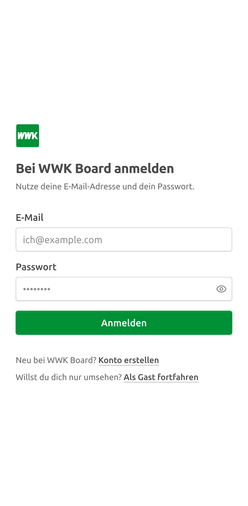
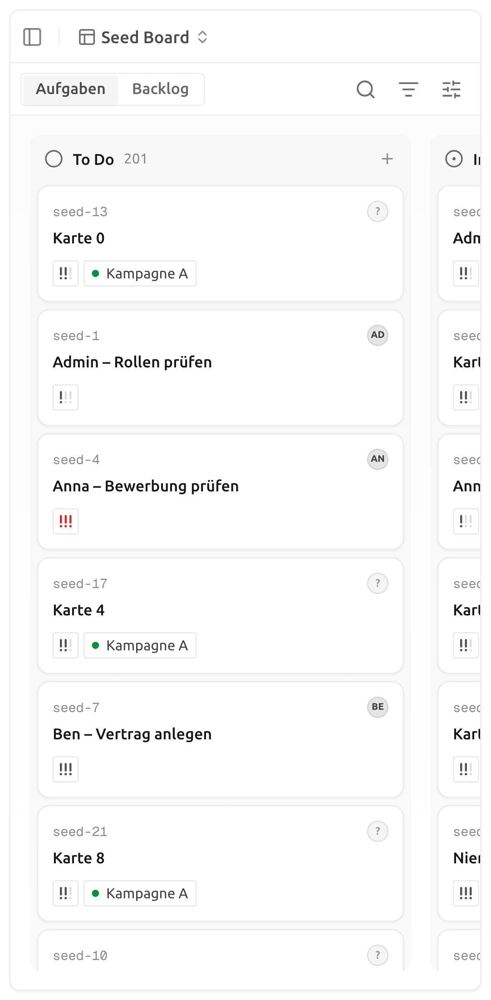

# WWK-Erscheinungsbild durchgängig — Stand, Umsetzung, Nachweis

| | |
|---|---|
| **Story** | PEGA-92: Als WWK möchte ich die Plattform durchgängig im eigenen Erscheinungsbild sehen, auch am Smartphone |
| **Bezug** | Stakeholder-Sync 2026-10-20 (Robert Baumann: zunächst WWK-Farben, weil der WWK-Außendienst damit arbeitet; weitere Gesellschaften wie 1zu1 später, Entscheidung über eine Unterscheidung bei Michael Polaczek); Daily 2026-10-21 (Brand-Package von Niklas Finnemann); [Theming-Dokument](../theming-wwk.md); [Register der Fork-Eingriffe](../fork-eingriffe.md#wwk--theming) |
| **Stand** | 2026-10-21, Fork `IAMDS-GMBH/pegasus-board`, Branch `th_PEGA-92` auf Basis `main` @ `95b3e645` (Upstream v2.46.2+141 mit PEGA-87/88) |
| **Autor** | IAMDS |

Pfadangaben beziehen sich auf die Repo-Wurzel.

---

## 0. Ergebnis auf einer Seite

| Abnahmekriterium | Befund |
|---|---|
| Titel, App-Name und Icons zeigen das WWK-Produkt | **Erfüllt.** `index.html` wird im Build für die Marke umgeschrieben: Titel und App-Name „WWK Board“, WWK-Favicons, Apple-Touch-Icon, eigenes Manifest mit vier PWA-Icons (zwei davon `maskable`). Die Mobile-App heißt „WWK Board“ und hat WWK-Icons, Splash und Logo (Abschnitt 2). |
| In der Oberfläche erscheint kein Kaneo mehr | **Erfüllt für die Web-Oberfläche**, geprüft im Browser auf 15 Seiten (Abschnitt 3). Dazu tragen E-Mails, Chat-Benachrichtigungen und die Mobile-App den WWK-Namen. Bewusst geblieben sind technische Kennungen (Abschnitt 4). |
| Die mobile Ansicht ist auf einem echten Gerät geprüft | **Offen.** Im Browser mit Pixel-7-Emulation geprüft (kein waagrechter Überlauf). Die Prüfung auf einem echten Android-Gerät mit Chrome und installierter PWA steht noch aus (Abschnitt 3.3). |

**Vorher schon erledigt** (WWK-Theme vom 2026-09-29/10-01): Farben, Ubuntu, Radius, Logo auf der Anmeldeseite, Tab-Titel zur Laufzeit, Hell als Standard. Offen waren genau die Grenzen 2, 3 und 7 aus dem [Theming-Dokument](../theming-wwk.md#grenzen-des-themings).

**Dunkel-Design repariert.** Die Grautöne des WWK-Themes galten auch im Dunkelmodus: dunkelgrauer Text `#4a4a4a` auf dunklem Grund, hellgraue Flächen. Ursache: Der Block `.theme-wwk` steht in `apps/web/src/index.css` nach `.dark` und hat dieselbe Spezifität. Die Grautöne gelten jetzt nur noch im Hellmodus (`.theme-wwk:not(.dark)`). Hell bleibt Standard.

**Entscheidungen** (mit dem Auftraggeber abgestimmt):

- **Name „WWK Board“** überall: Tab, PWA, Texte, E-Mails, Mobile-App.
- **Umfang:** alle 21 Sprachen der Web-Oberfläche, Upstream-Links und -Hinweise, E-Mails der API, Mobile-App.
- **AGB-/Datenschutz-Links vorerst ausgeblendet**, bis WWK-Adressen feststehen.
- **Prüfung am echten Gerät:** Android, Chrome, als PWA.
- **Marke bleibt umschaltbar.** `VITE_BRAND` (Web, Build-Zeit) und `APP_NAME` (API) bleiben die Stellen, an denen später weitere Gesellschaften wie 1zu1 ansetzen könnten.

---

## 1. Brand-Package

Abgleich mit dem Package aus dem Kundenordner (nicht im Repository):

| Inhalt | Befund |
|---|---|
| Logos `wwk-logo-{4c,rgb,1c,negativ}.svg/png` | `apps/web/public/brands/wwk/logo.svg` ist inhaltlich identisch mit `wwk-logo-rgb.svg`, das Negativ ebenso. Keine Änderung nötig. |
| Schrift Ubuntu (8 Schnitte, UFL 1.0) | Dieselbe Familie, die die App über `@fontsource/ubuntu` lädt. Keine Änderung nötig. |
| Hex-Werte | **Kein Farbblatt im Package.** Bestätigt sind nur Grün `#009036` und Orange `#ee7d00` aus den Logodateien. Textgrau `#4a4a4a`, CTA-Orange `#ee6608` und die Grautöne stammen weiter von wwk.de (Abschnitt 4). |

## 2. Umsetzung

| Schicht | Änderung |
|---|---|
| Web, Build | Vite-Plugin `apps/web/brand-html-plugin.ts` mit `brandIndexHtml()` schreibt den Kopf von `index.html` für die Marke um: Titel, Beschreibung, `application-name`, `apple-mobile-web-app-title`, Favicons (SVG, PNG 96, ICO 16/32/48), Apple-Touch-Icon 180, Manifest, `theme-color`. OpenGraph-/Twitter-Tags, `canonical` und das Plausible-Skript von kaneo.app entfallen. `index.html` bleibt die Upstream-Datei. |
| Web, PWA | `apps/web/public/brands/wwk/site.webmanifest`: Name und Kurzname „WWK Board“, `start_url` `/`, Hintergrund und Theme Weiß (helle Oberfläche), Icons 192/512 `any` und `maskable`. Das `maskable`-Icon hat eine kleinere Wortmarke in der Android-Schutzzone. |
| Web, Theme | Grautöne nur im Hellmodus (Dunkel-Fehler, siehe oben). Anmelde- und Onboarding-Seite zeigen das WWK-Favicon statt der Kaneo-Marke. Diese Stelle war mit dem Upstream-Sync vom 2026-10-19 hinzugekommen. |
| Web, Texte | `{{appName}}` statt „Kaneo“ in den Namensräumen `common`, `auth`, `settings`, `invitations`, `mobile`, in allen 21 Sprachen. „Powered by Kaneo“, AGB-/Datenschutz-Links und der Doku-Link bei CORS-Fehlern sind ausgeblendet (`brand.upstreamLinks`). Der Import „Andere WWK Board-Instanz“ nutzt Name und Icon der Marke, ebenso der App-Name gegenüber Trello. |
| API, E-Mail | `APP_NAME` (Standard „WWK Board“) in `packages/email/src/components/app-name.ts`. Betreffzeilen (Anmeldelink, Code, Passwort, Einladung), Texte und Wortmarke aller E-Mails, Mark `mark-wwk.png`. Die Fußzeile zeigt keine kaneo.app-Links mehr. |
| API, Chat und Benachrichtigungen | Ersatztexte für Benachrichtigungen (E-Mail, ntfy, Gotify, Webhook) und „Ausgelöst von“ in Slack, Discord, Telegram und Mattermost nennen `APP_NAME`. Import-Meldungen kommen ohne Produktnamen aus („Der Server wurde während des Imports neu gestartet“). |
| Mobile-App | Name „WWK Board“, Icon, adaptives Android-Icon (grün), Monochrom-Icon, Splash, Benachrichtigungs-Icon und -farbe, WWK-Logo auf der Anmeldeseite. Die Auswahl „Kaneo Cloud / Selbst gehostet“ entfällt, weil WWK eigene Server betreibt: Man gibt direkt die Serveradresse ein. Unverändert bleiben Paket-ID `de.usekaneo.kaneo`, Schema `kaneo://` und Speicherschlüssel, sonst bräche das Update bestehender Installationen und die Geräte-Anmeldung. |
| Skripte | `pnpm i18n:brand` (`scripts/i18n/brand-app-name.mjs`) setzt `{{appName}}` nach einem Upstream-Sync erneut, idempotent. |

## 3. Nachweis

### 3.1 Browser

Playwright mit Chromium gegen die lokale Entwicklungsumgebung (API `:1337`, Web `:5173`, Benutzer `admin@seed.test`, Oberfläche Deutsch, Projekt „Seed Board“ mit 1.012 Karten).

**Kein „Kaneo“ im sichtbaren Text und im Tab-Titel:** Anmeldung (hell, dunkel), Board (hell, dunkel), Board am Smartphone sowie die Einstellungen Konto (Informationen, Benachrichtigungen, Entwickler, Einstellungen, Sicherheit), Workspace (Allgemein, Import, Abrechnung, Rollen), Administration (Benutzer, Workspaces) und Projekt (Allgemein, Integrationen).

**Kopf und Manifest:** Der Entwicklungsserver und der Produktions-Build (`vp build`, `dist/index.html`) liefern `<title>WWK Board</title>`, das WWK-Manifest und keinen Treffer für „kaneo“. `/brands/wwk/site.webmanifest` kommt als `application/manifest+json` mit Name „WWK Board“ und vier Icons.

| Ansicht | Hell | Dunkel |
|---|---|---|
| Anmeldeseite |  |  |
| Board |  |  |

### 3.2 Smartphone-Emulation

Pixel 7 (Playwright-Profil, 412 × 839, Touch, Chromium): Anmeldung, Startseite und Board sind lesbar. Das Board hat keinen waagrechten Überlauf der Seite (`scrollWidth − clientWidth = 0`); die Spalten scrollen wie bisher seitlich.

| Anmeldung | Board |
|---|---|
|  |  |

### 3.3 Echtes Gerät (offen)

Android-Telefon mit Chrome, per USB am Entwicklungsrechner. `adb reverse` macht `localhost` auf dem Telefon zum Rechner. Damit gilt die Seite als sicherer Ursprung und lässt sich als PWA installieren:

```bash
adb reverse tcp:5173 tcp:5173
adb reverse tcp:1337 tcp:1337
# Telefon: Chrome → http://localhost:5173
```

Zu prüfen und hier mit Screenshots nachzutragen:

1. Anmeldung, Startseite, Board, Karte öffnen, Filter, Einstellungen im Hoch- und Querformat.
2. Menü → „Zum Startbildschirm hinzufügen“ bzw. „App installieren“. Name „WWK Board“, Icon grün mit WWK-Wortmarke, ohne abgeschnittene Buchstaben.
3. PWA vom Startbildschirm starten: Splash weiß mit Icon, Statusleiste weiß, kein „Kaneo“ im App-Wechsler.
4. Dunkelmodus (Einstellungen → Darstellung) kurz gegenprüfen.

### 3.4 Automatisierte Tests

| Test | Inhalt |
|---|---|
| `apps/web/src/brand/brand-index-html.test.ts` (neu) | WWK-Kopf aus der echten `index.html` ohne „kaneo“; Titel, App-Namen, Manifest, Icons, `theme-color`; Kaneo-Marke lässt die Datei unverändert; App-Skript bleibt |
| `apps/web/src/brand/brands.test.ts` (umbenannt) | Markenauflösung wie bisher |
| `packages/email/src/components/app-name.test.ts` (neu) | Standard „WWK Board“, `APP_NAME`, Ersetzung in verschachtelter Kopie und Kopie-Funktionen; Anmeldelink-, Passwort- und Einladungs-E-Mail ohne „kaneo“ und mit `mark-wwk.png` |
| `tests/api/utils/get-invitation-email-subject.test.ts` | Einladungsbetreff in sechs Sprachen mit „WWK Board“ |
| `apps/web/.../trello-authorize-url.test.ts`, `apps/api/src/import/*.test.ts`, `tests/api-integration/import.test.ts` | an neue Texte angepasst |

Gelaufen: Typprüfung Web (App und Vite-Konfiguration), API, E-Mail und Mobile-App; `vp check` auf allen geänderten Dateien; `pnpm i18n:check`; Unit-Tests Web (1.614), API (1.238), E-Mail (43), Mobile-App (105) grün; `vp build` des Web. Nicht gelaufen: Integrationstests (`tests/api-integration/import.test.ts` hat nur einen geänderten Erwartungstext).

## 4. Offene Punkte und bewusste Ausnahmen

- **Echtes Gerät** (Abschnitt 3.3).
- **Farbblatt von WWK.** Ohne offizielle Hex-Werte für Text, Flächen und Akzente bleiben die von wwk.de abgeleiteten Werte. Bei Lieferung nur die Variablen `--brand-*` in `apps/web/src/index.css` anpassen.
- **Impressum und Datenschutz.** Die Links sind ausgeblendet. Sobald WWK-Adressen feststehen, lassen sie sich als Markenfeld ergänzen (Web und E-Mail-Fußzeile).
- **Link-Vorschau.** Ohne OpenGraph-Bild zeigen Messenger nur Titel und Beschreibung.
- **Technische Kennungen bleiben „kaneo“:**
  - der Header `X-Kaneo-Signature`, der im Hinweis des generischen Webhooks genannt wird
  - die Geräte-Client-ID `kaneo-cli` in einer Fehlermeldung bei falsch konfiguriertem Server
  - Paket-ID und Schema der Mobile-App
  - der Dateiname `kaneo.ics` des Kalender-Feeds
  - MCP-Servername, OpenAPI-Titel und -Beschreibungen (Entwickler, nicht Endnutzer)
  - Umgebungsvariablen `KANEO_*`
- **Nur Cloud-relevant, nicht angepasst:** die E-Mail „Kaneo Cloud trial“ und die Meldung zum abgelaufenen Cloud-Plan. Beide erscheinen nur mit aktivierter Abrechnung.
- **Sprachliche Feinheiten.** Zusammensetzungen lauten „WWK Board-Instanz“ statt „WWK-Board-Instanz“. Im Koreanischen passen die Partikel nach dem Namen nicht immer.
- **Mobile-App nicht gebaut.** Die Prüfung erfolgte über Typprüfung und Tests; ein Android-Build mit den neuen Icons steht aus. Die Prüfung am Gerät betrifft die PWA.

## 5. Upstream-Sync

1. Upstream-`i18n/*.json` übernehmen, dann `pnpm i18n:brand` und `pnpm i18n:check`.
2. `apps/web/src/brand/brand-index-html.test.ts` zeigt, ob eine geänderte `index.html` wieder „Kaneo“ in den Kopf bringt.
3. Neue E-Mail-Templates bekommen `withAppName()` auf ihre Kopie.
4. Neue hart codierte Nennungen findet `grep -rn '"Kaneo\|kaneo\.app' apps/web/src apps/mobile/src`.
