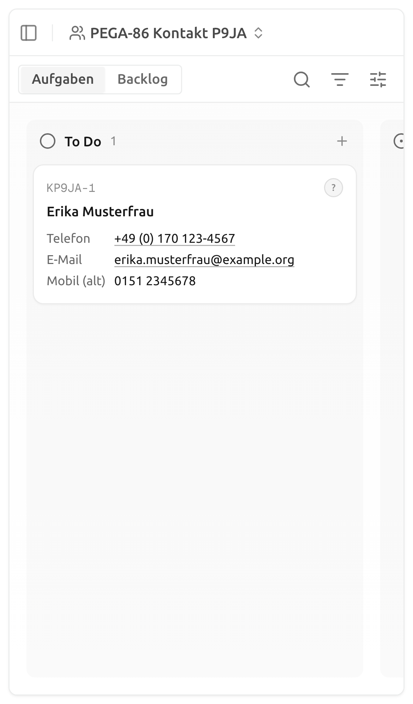
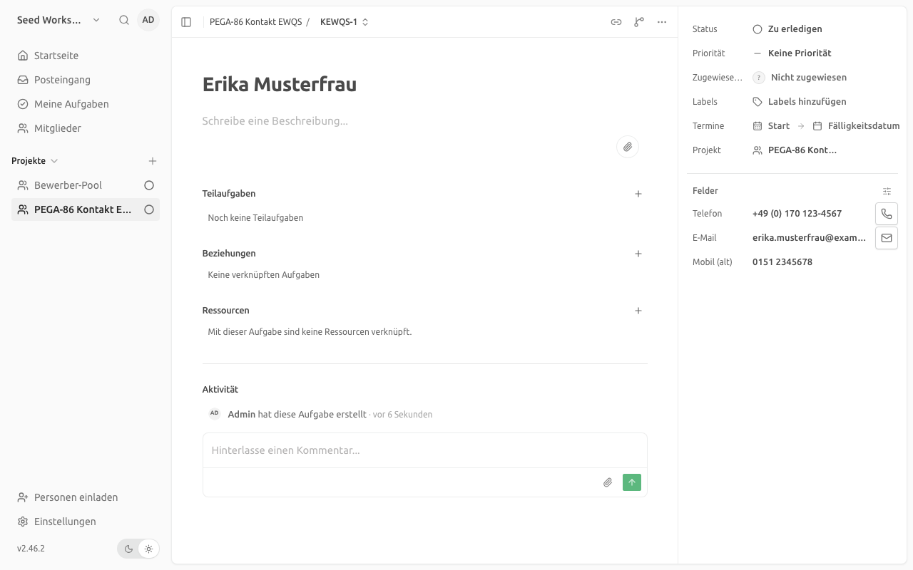
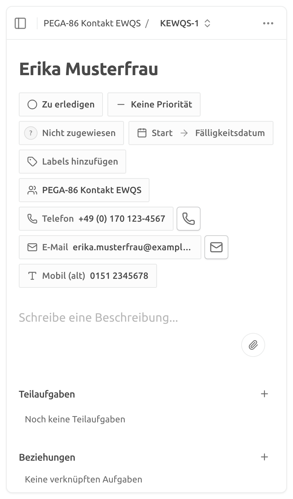
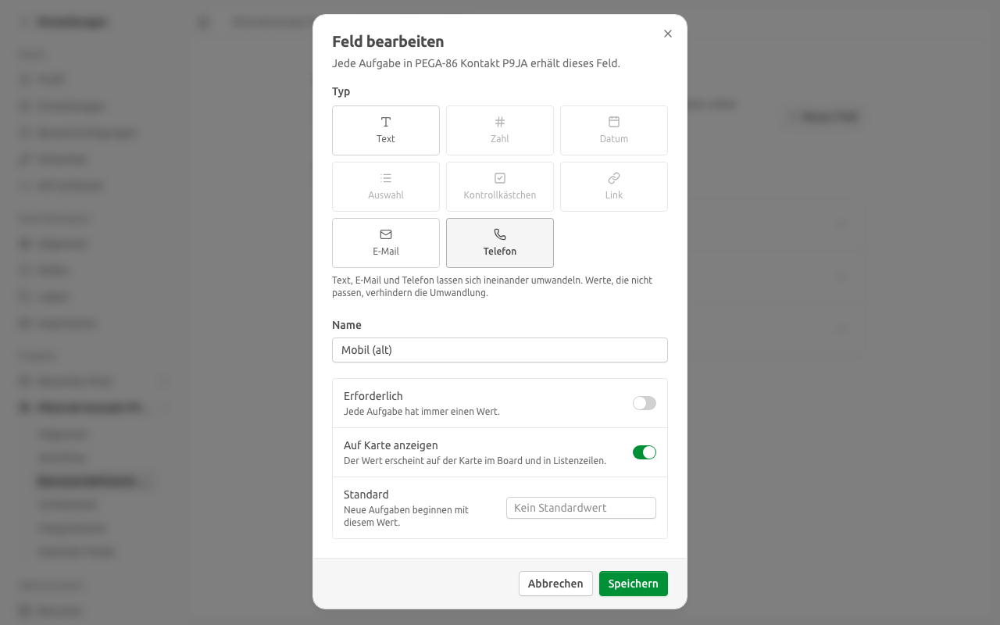

# Telefon und E-Mail an der Karte anklickbar — Umsetzung und Nachweis

| | |
|---|---|
| **Story** | PEGA-86: Als Innendienst möchte ich die Bewerberdaten strukturiert an der Karte haben, damit ich nicht im Kommentartext suche. Hier umgesetzt: **Nachtrag 23.10.2026 (Zwischenreview)**, Telefonnummer und E-Mail-Adresse an der Karte als anklickbare Links |
| **Bezug** | Feinkonzept v3.10, Kap. 11 Baustein 3 und Kap. 13; Review Alexander Sitzmann („Grunderwartung“); [Board-Einrichtung](2026-10-board-einrichtung.md) (PEGA-84); [Custom-Field-Typ Link](2026-10-custom-field-link.md) (PEGA-87) als Vorlage; [Register der Fork-Eingriffe](../fork-eingriffe.md#pega-86--custom-field-typen-email-und-phone) |
| **Stand** | 2026-10-28, Fork `IAMDS-GMBH/pegasus-board`, Branch `th_PEGA-86` auf Basis `main` @ `d0c6b85e` |
| **Autor** | IAMDS |

Pfadangaben beziehen sich auf die Repo-Wurzel.

---

## 0. Ergebnis auf einer Seite

| Kriterium | Befund |
|---|---|
| Telefonnummer an der Karte startet mit einem Tipp den Anruf | **Erfüllt.** Neuer Feldtyp „Telefon“ (`phone`). Der Wert ist auf der Board-Karte, im Überlauf, in Listen- und Backlog-Zeilen und in der Kartenansicht ein `tel:`-Link. Er öffnet die Telefon-App im selben Tab, ohne die Karte zu öffnen oder zu ziehen. Geprüft am Desktop und in der Smartphone-Ansicht (Abschnitt 3). |
| E-Mail-Adresse an der Karte startet mit einem Tipp eine Mail | **Erfüllt.** Neuer Feldtyp „E-Mail“ (`email`), gleiches Verhalten mit `mailto:`. |
| Feldtypen passen zum Inhalt | **Für Telefon und E-Mail erfüllt.** Beide Typen prüfen ihre Werte. Die übrigen Standardfelder aus Kapitel 13 (Datum, Auswahl, Zahl, Text) sind seit [PEGA-84](2026-10-board-einrichtung.md) angelegt und gehören nicht zu diesem Nachtrag. |
| Bestehendes Board lässt sich ohne Datenverlust umstellen | **Erfüllt.** Ein Textfeld lässt sich in ein E-Mail- oder Telefonfeld umwandeln, über den Feld-Dialog und über das Board-Skript. Die Werte auf den Karten bleiben erhalten. |

**Upstream hat keine solchen Typen.** Geprüft am 2026-10-28 in `usekaneo/kaneo` `main` (`49d72079`): Das Typ-Enum in `apps/api/src/custom-field/schema.ts` kennt `text`, `number`, `date`, `dropdown`, `boolean` und `multiselect`. Es gab also kein Update zu übernehmen; die Typen sind ein Fork-Eingriff nach dem Muster von PEGA-87.

**Entscheidungen (mit dem Auftraggeber abgestimmt):**
1. **Eigene Feldtypen statt Erkennung im Text.** Ein Textfeld, das „wie eine Nummer aussieht“, wäre eine Heuristik: Eine PLZ oder eine ID könnte zum Anruf-Link werden. Ein Typ macht die Absicht eindeutig und passt zu „Feldtypen festlegen“ aus der Story.
2. **Strenge Prüfung überall**, auch beim Anlegen einer Karte durch den Hub. **Folge für den Hub:** Ein Lead mit „keine Angabe“ oder einer Telefonnummer mit Buchstaben wird mit 400 abgelehnt. Der Hub muss solche Werte vor dem Senden bereinigen oder weglassen (Abschnitt 5).
3. **Nur die Web-App zeigt Links**, auch im Smartphone-Browser, mit dem der Innendienst arbeitet. Die Expo-App kennt die Typen und bietet die passende Tastatur an, zeigt aber noch keine Links.

---

## 1. Verhalten

- **Telefon speichern:** Eingaben werden getrimmt und innere Leerzeichen zusammengefasst. Sonst bleibt die Schreibweise erhalten (`+49 (0) 170 123-4567`), weil Leads in jeder lokalen Notation ankommen. Erlaubt sind Ziffern, Leerzeichen, `+` am Anfang und `( ) / . -`. Nötig sind 5 bis 15 Ziffern; ein führendes `00` und `(0)` nach der Ländervorwahl zählen nicht mit.
- **Telefon wählen:** Der Link enthält nur `+` und Ziffern. `(0)` nach der Ländervorwahl entfällt, weil es im internationalen Format nicht gewählt wird: `+49 (0) 170 123-4567` → `tel:+491701234567`, `0170 1234567` → `tel:01701234567`.
- **E-Mail speichern:** getrimmt. Abgelehnt werden fehlendes oder doppeltes `@`, Domains ohne Punkt, Leerzeichen, mehr als 254 Zeichen und die Zeichen `? # & , ; : < > " ( ) [ ] \`. Letztere würden im `mailto:`-Link weitere Empfänger oder Betreff und Text einschleusen (`max@example.org?cc=…`).
- **Anzeige:** Der Wert steht wie gespeichert an der Karte, unterstrichen als Link. In der geöffneten Karte steht neben dem Wert eine umrandete Symbol-Schaltfläche mit Telefon bzw. Brief („Telefon anrufen“, „E-Mail an E-Mail“). Sie ist 32 × 32 px groß (vorher ein 28-px-Symbol ohne Rahmen) und am Smartphone so hoch wie das Feld daneben. Auf Touch-Geräten ist die Tippfläche mindestens 44 px groß. Ein Link entsteht nur aus einem gültigen Wert; ein Altwert, der die Regel nicht erfüllt, erscheint als Text.
- **Öffnen:** `tel:` und `mailto:` öffnen im selben Tab die Telefon- bzw. Mail-App, ohne neuen Tab. Klick, Zeiger, Maus, Touch und Tastatur auf dem Link öffnen die Karte nicht und starten keinen Ziehvorgang.
- **Bearbeiten:** Das Eingabefeld hat `type="tel"` bzw. `type="email"`, damit das Smartphone Ziffernblock bzw. @-Tastatur zeigt. Ein ungültiger Wert wird nicht gespeichert, und der Editor nennt den Grund („Gib eine gültige Telefonnummer ein, z. B. 0170 1234567.“).
- **Typwechsel:** Text, E-Mail und Telefon lassen sich ineinander umwandeln. Im Feld-Dialog sind beim Bearbeiten eines solchen Felds nur diese drei Typen wählbar. Beim Wechsel zu E-Mail oder Telefon werden alle Kartenwerte in die gespeicherte Form gebracht. Passt ein Wert nicht, lehnt die API den Wechsel ab (`CUSTOM_FIELD_TASKS_HAVE_INVALID_VALUES`, „Bei einigen Aufgaben passt der Wert nicht zum neuen Typ. Korrigiere oder leere diese Werte zuerst.“), und nichts ändert sich. Zurück zu Text geht immer. Alle anderen Typwechsel bleiben gesperrt.
- **Keine Migration:** `custom_field_definition.type` ist eine Textspalte.

## 2. Umsetzung

| Schicht | Änderung |
|---|---|
| API | Regeln in `custom-field/email-value.ts` und `phone-value.ts`; gemeinsames Speichern in `stored-value.ts`; Typen im Zod-Enum mit OpenAPI-Beschreibung; Prüfung beim Setzen eines Werts, beim Anlegen einer Karte und bei Standardwerten; Typwechsel in `resolve-field-update.ts` und `plan-text-value-changes.ts`; Umschreiben der Werte in derselben gesperrten Transaktion wie Auswahl ↔ Mehrfachauswahl |
| Web | Typen „E-Mail“ und „Telefon“ im Feld-Dialog (Typauswahl jetzt 3 × 3), freigegebener Wechsel innerhalb Text/E-Mail/Telefon; `customFieldHref` als ein Einstieg für alle Link-Typen; `CustomFieldLink` öffnet nur Web-Links in neuem Tab; Symbol je Typ in Kartenansicht und Listenzeilen; Eingaben mit `tel`/`email`; Fehlermeldungen je Typ |
| Mobile | Typen in der Feldverwaltung, Grobprüfung des Standardwerts, Tastaturen `phone-pad` und `email-address` (`features/project/field-keyboard.ts`) |
| CLI, MCP | `kaneo field create --type phone` (Alias `tel`) bzw. `--type email` (Alias `mail`); Werte prüft die API; MCP-Toolbeschreibungen nennen die Typen und ihre Form |
| Board-Skript | `board.json`: Telefon `phone`, E-Mail `email`; `plan-fields.mjs` plant den Wechsel von Text als Feld-Update statt als Fehler |
| i18n | Deutsch und Englisch übersetzt, übrige Sprachen mit englischem Fallback; `i18n/schema.json` von Hand ergänzt |

71 Code- und Testdateien ohne Übersetzungen, davon 19 neu. Die Regeln stehen wie bei PEGA-87 zweimal (API, Web), damit der Editor sofort prüft und der optimistisch angezeigte Wert dem gespeicherten entspricht.

## 3. Nachweis

Playwright gegen die lokale Entwicklungsumgebung (API `:1337`, Web `:5173`, Benutzer `admin@seed.test`, Oberfläche Deutsch). Wegwerfprojekt „PEGA-86 Kontakt“ mit den Feldern Telefon (`phone`), E-Mail (`email`) und „Mobil (alt)“ (`text`), alle auf der Karte, danach wieder gelöscht. 22 Prüfungen, alle grün.

**Board, Smartphone-Ansicht** (iPhone 13, 390 × 844): Telefon und E-Mail sind Links (`tel:+491701234567`, `mailto:erika.musterfrau@example.org`) ohne `target`. Ein Tipp auf den Link öffnet die Karte nicht (URL unverändert). „Mobil (alt)“ ist noch ein Textfeld und bleibt Text. Dieselben Prüfungen laufen in der Desktop-Ansicht (1280 × 800, [Bildschirmfoto](../images/custom-field-kontakt-karte-desktop.png)).

**Kartenansicht:** Neben Telefon und E-Mail stehen die Schaltflächen „Telefon anrufen“ (`tel:`) und „E-Mail an E-Mail“ (`mailto:`). Am Desktop sitzen sie in der Seitenleiste, am Smartphone neben den Feldern unter dem Titel; dort sind sie 32 × 32 px groß (gemessen).

**Feld umwandeln:** Einstellungen → Projekt → Benutzerdefinierte Felder → „Mobil (alt)“ bearbeiten. Wählbar sind nur Text, E-Mail und Telefon; Zahl, Datum, Auswahl, Kontrollkästchen und Link sind gesperrt. Nach „Telefon“ und „Speichern“ ist das Feld vom Typ `phone`, und der Kartenwert `0151  2345678` ist als `0151 2345678` gespeichert (per API geprüft).

**Hub-Import:** `POST /api/task/{projectId}` mit Telefon „keine Angabe“ gibt 400.

**Automatisierte Tests** (testgetrieben: jeder Test lief zuerst rot, dann grün):

| Test | Inhalt |
|---|---|
| `tests/api-integration/custom-field-contact.test.ts` (neu, 15 Fälle) | Speichern in Normalform; 400 mit genauer Meldung für ungültige Werte; Leeren; ungültige Werte beim Anlegen einer Karte (keine Karte entsteht); gültige Werte beim Anlegen; ungültiger Standardwert; Text → Telefon schreibt Werte um; Text → E-Mail mit unpassendem Wert gibt `CUSTOM_FIELD_TASKS_HAVE_INVALID_VALUES` und ändert nichts; Telefon → Text |
| `tests/api/custom-field/email-value.test.ts`, `phone-value.test.ts`, `stored-value.test.ts`, `plan-text-value-changes.test.ts` (neu), `resolve-field-update.test.ts` (erweitert) | Regeln der API; gespeicherte Form; Planung der Umwandlung; erlaubte und gesperrte Typwechsel, Standardwert beim Wechsel |
| Web: `custom-field-email.test.ts`, `custom-field-phone.test.ts`, `custom-field-href.test.ts`, `custom-field-row.test.tsx` (neu); `card-field-rows.test.tsx`, `card-field-list.test.tsx`, `custom-field-chip.test.tsx`, `kanban-board/task-card.test.tsx`, `field-form.test.ts`, `custom-field-dialog.test.tsx`, `describe-custom-field.test.ts`, `custom-field-error-key.test.ts`, `lib/i18n/custom-field-translations.test.ts` (erweitert) | Regeln und `tel:`-Ziffern im Web; Links auf Karte, Liste und Kartenansicht ohne neuen Tab; kein Link aus ungültigen Werten; Klick öffnet die Karte nicht, Halten startet keinen Ziehvorgang; Editor speichert die Normalform und nennt den Fehler; Standardwert im Dialog; Typwechsel im Dialog; Fehlercode übersetzt |
| `apps/mobile/.../field-form.test.ts`, `packages/cli/.../field-types.test.ts`, `scripts/board-setup/plan-fields.test.mjs` | Grobprüfung Mobile, Typen und Aliasse CLI, Typwechsel im Board-Skript |

**Gelaufen:**

| Befehl | Ergebnis |
|---|---|
| `pnpm exec vp check` (alle geänderten Code- und Testdateien) | grün |
| `pnpm --filter @kaneo/api exec vp test run --config vitest.config.ts ../../tests/api/` | 129 Dateien, 1011 Tests grün |
| `pnpm --filter @kaneo/api exec vp test run --config vitest.integration.config.ts` (volle Suite) | 159 Dateien, 1788 Tests grün, 3 übersprungen |
| `pnpm --filter @kaneo/web exec vp test run --config vitest.config.ts` | 322 Dateien, 1716 Tests grün |
| `pnpm --filter @kaneo/mobile exec vp test run --config vitest.config.ts` | 111 Tests grün |
| `pnpm --filter @kaneo/cli exec vp test run --config vitest.config.ts`, `pnpm --filter @kaneo/mcp test` | 841 bzw. 62 Tests grün |
| `node --test scripts/board-setup/*.test.mjs` | 32 Tests grün |
| `pnpm --filter @kaneo/{api,web,mobile,cli} typecheck`, `tsc --noEmit` in `packages/mcp` | ohne Fehler |
| `pnpm openapi:check:fix`, `pnpm i18n:check:fix` | `apps/docs/openapi.json` neu erzeugt; alle Locales synchron |

## 4. Konfliktpotenzial beim Upstream-Abgleich

- Überwiegend additiv. Die Verzweigungen in Upstream-Dateien stehen im [Register](../fork-eingriffe.md#pega-86--custom-field-typen-email-und-phone).
- Neue Upstream-Abfragen `field.type === "url"` müssen über `isLinkFieldType` bzw. `customFieldHref` laufen, sonst fehlen Telefon und E-Mail.
- Führt Upstream eigene Kontakt-Typen ein, sollte der Fork deren Namen übernehmen und gespeicherte Definitionen per Datenmigration umstellen.
- Die Typen sind generisch; ein PR an Upstream würde den Eingriff überflüssig machen (nur nach Abstimmung).

## 5. Offen und Hinweise für den Betrieb

- **Hub:** Telefon und E-Mail werden beim Anlegen einer Karte geprüft. Ungültige Werte (z. B. „keine Angabe“, Telefonnummern mit Text wie „ab 18 Uhr“) führen zu 400, und die Karte entsteht nicht. Der Hub muss solche Werte vor dem Senden bereinigen oder das Feld weglassen. **An das Hub-Team weitergeben.**
- **Umstellung des Bewerber-Pools:** Nach dem Deployment `node scripts/board-setup/setup-board.mjs --workspace <Workspace-ID> --dry-run` ausführen (siehe [Board-Einrichtung](../board-einrichtung.md)). Der Lauf plant für Telefon und E-Mail den Typwechsel. Scheitert er am echten Lauf mit `CUSTOM_FIELD_TASKS_HAVE_INVALID_VALUES`, haben Karten noch Werte, die nicht passen. Diese erst korrigieren oder leeren und den Lauf wiederholen.
- **Expo-App:** Zeigt Telefon und E-Mail noch als Text (eigene Story, falls gewünscht).
- **Erster Teil der Story** (alle Standardfelder anlegen, Pflichtangaben festlegen) ist durch [PEGA-84](2026-10-board-einrichtung.md) abgedeckt und nicht Teil dieses Nachtrags.
