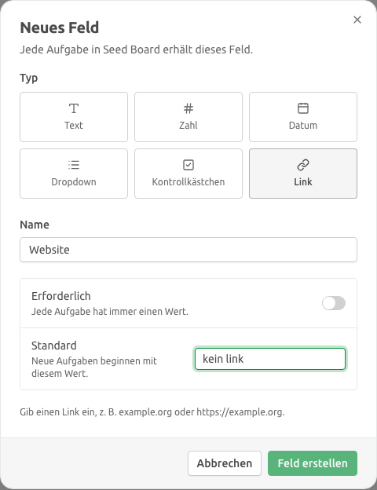
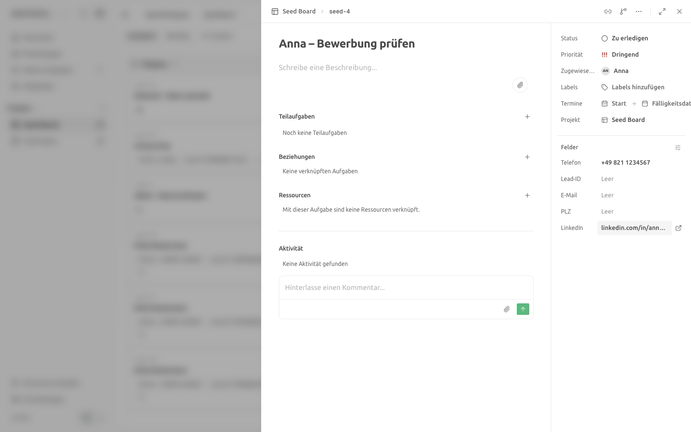
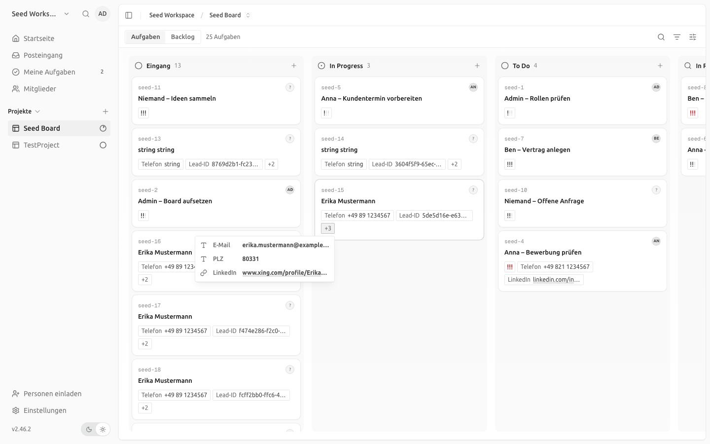

# Custom-Field-Typ „Link“ — Upstream-Prüfung, Umsetzung, Nachweis

| | |
|---|---|
| **Story** | PEGA-87: Als Innendienst möchte ich Verweise, etwa auf ein LinkedIn-Profil, als klickbaren Link am Lead speichern |
| **Bezug** | [Custom Fields](2026-10-custom-fields.md) Abschnitt 4 und 6 (Position „Typ `url`“, 0,5 PT); Feinkonzept v3.10, Kap. 11 Baustein 3; [Register der Fork-Eingriffe](../fork-eingriffe.md) |
| **Stand** | 2026-10-19, Fork `IAMDS-GMBH/pegasus-board`, Branch `th_PEG-87` auf Basis Upstream v2.46.2+141 |
| **Autor** | IAMDS |

Pfadangaben beziehen sich auf die Repo-Wurzel.

---

## 0. Ergebnis auf einer Seite

| Abnahmekriterium | Befund |
|---|---|
| Ein Feld vom Typ Link ist anlegbar, wird validiert und ist an der Karte klickbar | **Erfüllt.** Typ „Link“ im Feld-Dialog; ungültige Standardwerte sperren das Anlegen, ungültige Werte lehnen Editor und API ab (400). Der Link ist auf der Board-Karte, im Überlauf-Popover der Karte und in der Kartenansicht klickbar und öffnet einen neuen Tab, ohne die Karte zu öffnen oder zu ziehen (Abschnitt 3). |
| Der Eingriff ist für den Upstream-Abgleich dokumentiert | **Erfüllt.** Neues [Register der Fork-Eingriffe](../fork-eingriffe.md) mit allen Fork-Änderungen, Dateien, Prüfregeln und dem Sync-Ablauf; dieser Bericht. |

**Upstream hat keinen Link-Typ.** Geprüft am 2026-10-19 in `usekaneo/kaneo` `main` (`cfe528c1`): Das Typ-Enum in `apps/api/src/custom-field/schema.ts` kennt `text`, `number`, `date`, `dropdown`, `boolean`, `multiselect`; weder offene noch gemergte PRs oder Issues führen einen URL- oder Link-Typ. Ein Update zu übernehmen gab es also nicht; der Typ ist ein Fork-Eingriff.

**Vorher war ein Upstream-Sync nötig.** Upstream war seit dem letzten Abgleich 351 Commits weiter und hatte Custom Fields umgebaut (neuer Feld-Dialog, Werte als Chips auf der Karte, Felddefinition bearbeiten, Unterstützung in Mobile-App, CLI und MCP). Den Typ auf dem alten Stand zu bauen hätte ihn beim nächsten Sync verworfen. Deshalb zuerst der Sync (`cee0714f`, Nacharbeit `eb829b17`), dann der Typ auf der neuen Struktur. Beim Sync wurden zwei Lücken im Zeilenfilter geschlossen (Mehrfachrollen, Kalender-Feed); Details im [Zeilenfilter-Review](2026-10-zeilenfilter-fuehrungskraft.md#nachtrag-upstream-sync-2026-10-19).

Mit dem Sync erledigen sich auch drei Positionen aus [Custom Fields, Abschnitt 4](2026-10-custom-fields.md): Felddefinitionen lassen sich bearbeiten, Feldwerte erscheinen als Chips auf der Karte, und die Oberfläche ist auf Deutsch übersetzt.

---

## 1. Verhalten

- **Speichern:** Eingaben werden getrimmt; fehlt das Schema, wird `https://` ergänzt. Gespeichert wird die normalisierte Form: `linkedin.com/in/max` → `https://linkedin.com/in/max`.
- **Ablehnen:** alles außer `http`/`https` (`javascript:`, `data:`, `mailto:`, `ftp:`), Zugangsdaten in der URL, Leerzeichen, Hosts ohne Punkt (Tippfehler wie `asdf`; `localhost` ist erlaubt), mehr als 2048 Zeichen.
- **Anzeige:** ohne Schema und abschließenden Schrägstrich (`linkedin.com/in/max`). Ein Link entsteht nur aus einem gültigen http(s)-Wert; Altwerte, die die Regel nicht erfüllen, erscheinen als Text.
- **Öffnen:** neuer Tab mit `rel="noopener noreferrer"`. Klick, Zeiger, Maus, Touch und Tastatur auf dem Link werden nicht an die Karte weitergereicht.
- **Typwechsel** von und zu `url` bleibt wie bei Upstream gesperrt (nur Dropdown ↔ Mehrfachauswahl).
- **Keine Migration:** `custom_field_definition.type` ist eine Textspalte.

## 2. Umsetzung

| Schicht | Änderung |
|---|---|
| API | `custom-field/url-value.ts` (Regel, Normalisierung); Typ im Zod-Enum mit OpenAPI-Beschreibung; Prüfung in `validateCustomFieldValue`, `assertValidDefinition` und beim Setzen eines Werts; normalisiertes Speichern beim Setzen, Anlegen einer Karte, Anlegen und Bearbeiten eines Felds |
| Web | Typ „Link“ mit Icon im Feld-Dialog (Typauswahl jetzt 3 × 2), URL-Eingabe, Hinweis bei ungültigem Standardwert; Editor mit `type="url"` und Fehlermeldung; Link-Chip auf der Karte, Link im Überlauf-Popover, Öffnen-Symbol neben dem Wert in der Kartenansicht |
| Mobile | Typ in der Feldverwaltung, URL-Tastatur, Öffnen-Symbol im Kartendetail (Prüfung der Form, Normalisierung durch die API) |
| CLI, MCP | `kaneo field create --type url` (Alias `link`), Werte werden von der API geprüft; MCP-Toolbeschreibungen nennen den Typ |
| i18n | Deutsch und Englisch übersetzt, übrige Sprachen mit englischem Fallback |

44 Code- und Testdateien ohne Übersetzungen, davon 7 neu (Regel und Tests je Seite, zwei kleine Link-Komponenten, ein Integrationstest). Die Regel steht zweimal (API, Web), damit der Editor sofort prüft und der optimistisch angezeigte Wert dem gespeicherten entspricht.

## 3. Nachweis

Playwright gegen die lokale Entwicklungsumgebung (API `:1337`, Web `:5173`, PostgreSQL 16 aus `compose.dev.yml`, Benutzer `admin@seed.test`, Oberfläche Deutsch, Projekt „Seed Board“).

**Feld anlegen:** Einstellungen → Seed Board → Benutzerdefinierte Felder → „Neues Feld“ → Typ „Link“, Name `LinkedIn`. Standardwert `kein link` zeigt den Hinweis und sperrt „Feld erstellen“; ohne Standardwert wird das Feld angelegt.

**Wert setzen:** Karte `seed-4` → Feld „LinkedIn“ → `kein link` + Enter zeigt „Gib einen gültigen Link ein, z. B. linkedin.com/in/name.“ und speichert nicht. `linkedin.com/in/anna-beispiel` + Enter speichert `https://linkedin.com/in/anna-beispiel` (Datenbank geprüft). Das Symbol neben dem Wert öffnet das Profil in einem neuen Tab.

**Board:** Der Link-Chip auf `seed-4` öffnet einen neuen Tab; die Karte öffnet sich nicht. Ein Ziehversuch, der auf dem Link beginnt, verschiebt die Karte nicht (Status danach unverändert `to-do`). Auf `seed-15` liegt das Feld im Überlauf „+3“; der Link im Popover öffnet ebenfalls einen neuen Tab. Der Wert dort wurde per API als `www.xing.com/profile/Erika_Mustermann` gesetzt und als `https://www.xing.com/profile/Erika_Mustermann` gespeichert.

**Automatisierte Tests:**

| Test | Inhalt |
|---|---|
| `tests/api-integration/custom-field-url.test.ts` (neu, 10 Fälle) | Normalisierung beim Setzen; 400 für `javascript:`, `asdf`, `ftp://`, Zugangsdaten; Leeren; normalisierter Standardwert inkl. Befüllen bestehender Karten; ungültiger Standardwert; Werte beim Anlegen einer Karte; Bearbeiten des Standardwerts; gesperrter Typwechsel |
| `tests/api/custom-field/url-value.test.ts` (neu, 15 Fälle) | Regel der API |
| `apps/web/.../custom-field-url.test.ts` (neu), `card-field-list.test.tsx`, `format-custom-field-value.test.ts`, `field-form.test.ts`, `describe-custom-field.test.ts` | Regel im Web, Link mit `target`/`rel`, keine Weitergabe von Klick, Zeiger, Maus und Taste an die Karte, kein Link aus `javascript:`, Anzeige, Formularprüfung, Beschreibung |
| `apps/mobile/.../field-form.test.ts`, `packages/cli/.../field-types.test.ts` | Formprüfung Mobile, Typliste CLI |

Gelaufen: `pnpm typecheck`, `pnpm lint`, `pnpm i18n:check`, `pnpm openapi:check:fix` (Enum und Beschreibung in `apps/docs/openapi.json`), `pnpm test` (alle Pakete grün), Integrationstests `custom-field*`, `task-duplicate`, `task-view-assigned-only` grün. Die volle Integrationssuite lief nach dem Sync grün (1736 Tests).

## 4. Konfliktpotenzial beim Upstream-Abgleich

- Rein additiv bis auf einzelne Zweige in Upstream-Dateien; alle Stellen stehen im [Register](../fork-eingriffe.md#pega-87--custom-field-typ-url-link).
- Neue Upstream-Verzweigungen über Feldtypen brauchen einen `url`-Fall. TypeScript meldet fehlende Fälle in den Icon-Tabellen, in der CLI-Typliste und im Mobile-`switch`, nicht aber in `if`-Ketten.
- Führt Upstream später selbst einen Link-Typ ein, sollte der Fork dessen Typnamen übernehmen und gespeicherte Definitionen per Datenmigration umstellen.
- Der Typ ist generisch; ein PR an Upstream würde den Eingriff überflüssig machen.
