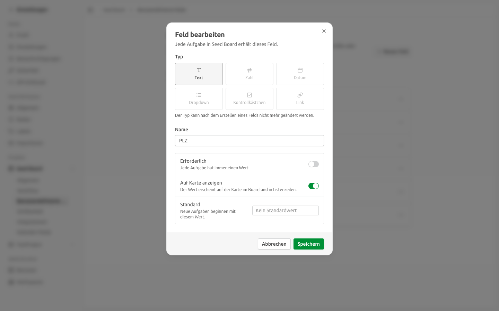
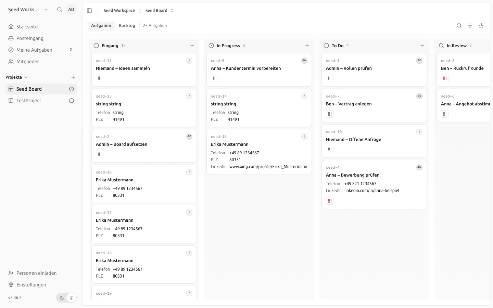
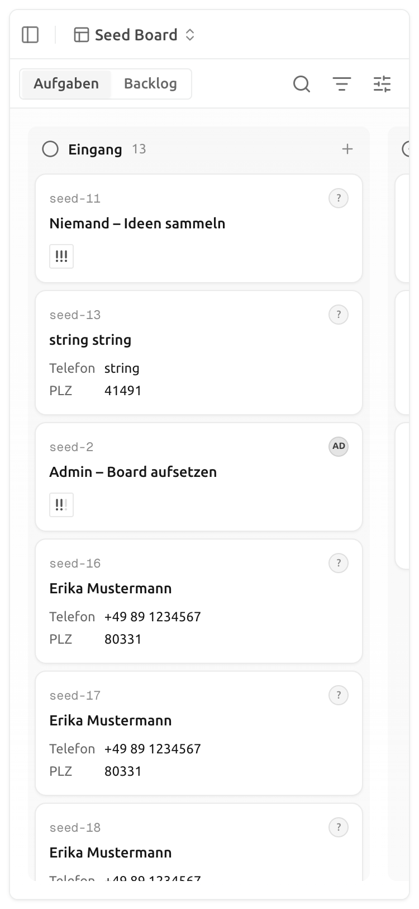

# Felder auf der Kartenvorschau — Upstream-Stand, Umsetzung, Nachweis

| | |
|---|---|
| **Story** | PEGA-88: Als Führungskraft möchte ich die wichtigsten Angaben schon in der Board-Ansicht sehen, damit ich nicht jede Karte öffnen muss |
| **Bezug** | [Custom Fields](2026-10-custom-fields.md) Abschnitt 4 und 6 (Position `visible_on_card`, 1–1,5 PT); Feinkonzept v3.10, Kap. 11 Baustein 2 („Karten-Vorschau zeigt die wichtigsten Custom Fields“) und Baustein 3 (`auf_karte_sichtbar`); [Register der Fork-Eingriffe](../fork-eingriffe.md#pega-88--felder-auf-der-kartenvorschau) |
| **Stand** | 2026-10-20, Fork `IAMDS-GMBH/pegasus-board`, Branch `th_PEGA-88` auf Basis `main` @ `3e44eb42` (Upstream v2.46.2+141 mit PEGA-87) |
| **Autor** | IAMDS |

Pfadangaben beziehen sich auf die Repo-Wurzel.

---

## 0. Ergebnis auf einer Seite

| Abnahmekriterium | Befund |
|---|---|
| Die konfigurierten Felder erscheinen auf der Kartenvorschau | **Erfüllt.** Neuer Schalter „Auf Karte anzeigen“ im Feld-Dialog der Projekteinstellungen. Alle eingeschalteten Felder stehen als Zeilen „Bezeichnung Wert“ unter dem Kartentitel, ohne Höchstzahl (Abschnitt 3). |
| Die Darstellung ist am Smartphone lesbar | **Erfüllt.** Zeilen in 12 px auf voller Kartenbreite, kein Hover nötig, kein waagrechtes Scrollen der Seite bei 375 px Breite; lange Werte werden mit „…“ gekürzt. Links öffnen auch per Tippen einen neuen Tab, ohne die Karte zu öffnen (Abschnitt 3). |

**Was Upstream schon konnte.** Seit dem Sync vom 2026-10-19 zeigt Kaneo Feldwerte auf der Karte, allerdings als höchstens zwei Chips mit auf ca. 96 px gekürzten Werten. Weitere Felder stecken hinter „+N“; dieses Popover und die Tooltips öffnen nur per Hover und sind am Smartphone nicht erreichbar. Welche Felder erscheinen, legt jeder Nutzer selbst fest (`hiddenCardFieldIds`, im Browser gespeichert, also je Gerät). Eine Auswahl durch den Administrator gibt es nicht.

**Entscheidungen** (mit dem Auftraggeber abgestimmt):

- **Administrator legt fest, Nutzer kann ausblenden.** Neue Spalte `custom_field_definition.show_on_card`. Die bestehende Nutzer-Einstellung bleibt und blendet freigeschaltete Felder für sich aus.
- **Standard aus**, auch für bestehende Felder. Bei rund 20 Standardfeldern (Baustein 3) wäre die Karte sonst überladen; der Administrator wählt z. B. Kampagne, Ort, Position, Paket, Score.
- **Zeilen statt Chips** auf der Board-Karte. Listen- und Backlog-Zeilen behalten die Chips (höchstens drei), zeigen aber ebenfalls nur freigeschaltete Felder.
- **Realtime für Feldwerte ist eine eigene Story** (0,5 PT, [Custom Fields, Abschnitt 4](2026-10-custom-fields.md)). Bis dahin erscheinen Werte, die der Hub oder ein anderer Nutzer setzt, erst nach Neuladen.

---

## 1. Verhalten

- **Einstellen:** Projekteinstellungen → Benutzerdefinierte Felder → Feld bearbeiten → „Auf Karte anzeigen“. Die Feldliste kennzeichnet solche Felder mit „Auf Karte“. Per API: `showOnCard` in `POST /custom-field` und `PUT /custom-field/{id}`.
- **Board-Karte:** Zeilen „Bezeichnung Wert“ zwischen Titel und Chip-Zeile, in Feldreihenfolge. Die Bezeichnung nimmt höchstens 40 % der Breite. Mehrfachauswahl zeigt zwei Optionen und „+N“, Datum mittellang („22. Okt. 2026“), Kontrollkästchen ein Häkchen, Link einen klickbaren Link. Leere Werte und nicht angehakte Kontrollkästchen entfallen, wie bisher bei den Chips. Erledigte Karten zeigen wie bisher keine Felder.
- **Anzeige-Optionen je Nutzer:** „Auf Karten anzeigen“ listet nur noch freigeschaltete Felder; ohne solche Felder entfällt der Abschnitt.
- **Rechte:** Der Schalter gehört zur Felddefinition (`project:update`). Die Werte kommen weiter über `GET /custom-field/project/{id}/values` mit dem Zeilenfilter „nur zugewiesene Karten“ (PEGA-5/6); die Antwort enthält zusätzlich `fieldShowOnCard`, es wird kein zweiter Request nötig.

## 2. Umsetzung

| Schicht | Änderung |
|---|---|
| Datenmodell | Spalte `show_on_card boolean DEFAULT false NOT NULL`, Fork-Migration `0065_custom_field_show_on_card.sql` (idempotent) |
| API | `showOnCard` in Anlegen, Bearbeiten und Felddefinition; `fieldShowOnCard` in den Feldwerten je Projekt und je Karte; OpenAPI nachgezogen |
| Web | Schalter im Feld-Dialog, Kennzeichnung in der Feldliste, Filter in `cardFieldsForTask`, neue Komponente `card-field-rows.tsx` auf der Board-Karte, Nutzer-Anzeigeoptionen auf freigeschaltete Felder beschränkt |
| i18n | Deutsch und Englisch übersetzt, übrige Sprachen mit englischem Fallback |
| Mobile-App, CLI, MCP | keine Änderung nötig (neue Felder sind optional, Typprüfung grün) |

## 3. Nachweis

Playwright mit Chrome gegen die lokale Entwicklungsumgebung (API `:1337`, Web `:5173`, PostgreSQL 16 aus `compose.dev.yml`, Benutzer `admin@seed.test`, Oberfläche Deutsch, Projekt „Seed Board“). Migration 0065 lief beim Start der API auf der bestehenden Entwicklungsdatenbank durch; alle sechs vorhandenen Felder standen danach auf „aus“.

**Einstellen:** Feld „PLZ“ → Bearbeiten: Schalter steht auf aus, wird eingeschaltet und gespeichert. „Telefon“ und „LinkedIn“ wurden per API (`PUT /custom-field/{id}` mit `showOnCard: true`) eingeschaltet.

**Desktop (1440 px):** Karten zeigen genau die drei Felder Telefon, PLZ, LinkedIn als Zeilen; „Lead-ID“, „E-Mail“ und „TestLink“ haben Werte, sind aber nicht freigeschaltet und erscheinen nicht. Ein Klick auf den LinkedIn-Link öffnet einen neuen Tab; die Karte öffnet sich nicht, die Board-URL bleibt gleich.

**Smartphone (375 × 812, Touch):** Seite ohne waagrechten Überlauf (`scrollWidth − clientWidth = 0`), Feldblock 268 px breit in 12 px Schrift, ein langer Link-Wert gekürzt. Tippen auf einen Link öffnet einen neuen Tab, ohne die Karte zu öffnen.

**Automatisierte Tests:**

| Test | Inhalt |
|---|---|
| `tests/api-integration/custom-field.test.ts` (neuer Fall) | Standard aus; Anlegen mit `showOnCard`; Umbenennen behält den Wert; Ein- und Ausschalten; `fieldShowOnCard` in den Werten je Projekt und je Karte |
| `tests/api/custom-field/resolve-field-update.test.ts` | Schalter setzen und beim Weglassen behalten |
| `apps/web/.../custom-fields/card-fields.test.ts` | nicht freigeschaltete Felder entfallen, Nutzer-Ausblenden wirkt weiter |
| `apps/web/.../custom-fields/card-field-rows.test.tsx` (neu) | Bezeichnung und Wert je Typ, Kontrollkästchen mit Bildschirmlesertext, Mehrfachauswahl mit „+N“, Datum formatiert, Link öffnet die Karte nicht |
| `apps/web/.../kanban-board/task-card.test.tsx` | alle Felder als Zeilen ohne „+N“; Halten auf einem Link startet kein Ziehen (ersetzt den Fall zum Überlauf-Knopf) |
| `field-form.test.ts`, `custom-field-dialog.test.tsx`, `custom-field-list.test.tsx`, `custom-field-toggles.test.tsx` | Schalter im Formular und in den Payloads, Kennzeichnung „Auf Karte“, Anzeigeoptionen nur mit freigeschalteten Feldern |

Gelaufen: Typprüfung für API, Web, Mobile-App und CLI, `vp check` auf allen geänderten Dateien, `pnpm i18n:check`, `pnpm openapi:check:fix` (Felder in `apps/docs/openapi.json`), `pnpm test` in Web und API, Integrationstests `custom-field*` und `task-view-assigned-only` grün.

## 4. Offene Punkte

- **Live-Aktualisierung der Feldwerte** (eigene Story, siehe oben). Für den Hub-Betrieb wichtig, weil der Hub Felder per API setzt.
- **Telefonnummer als Anruf-Link** (Feinkonzept Kap. 4, Mobil): Ein eigener Feldtyp `tel` oder eine Erkennung im Textfeld würde den Wert auf der Karte antippbar machen. Nicht Teil dieser Story.
- **Reihenfolge auf der Karte** folgt der Feldreihenfolge der Projekteinstellungen. Eine eigene Reihenfolge nur für die Karte gibt es nicht; bisher wurde keine gefordert.

## 5. Konfliktpotenzial beim Upstream-Abgleich

- Eine Fork-Migration mehr (0065); Regeln wie bei PEGA-6 (hinter die letzte Upstream-Migration, idempotent).
- Die Kartenanzeige liegt in Dateien, die Upstream mit dem Custom-Field-Umbau gerade angefasst hat (`task-card-content.tsx`, `card-fields.ts`). Die Einfügungen sind klein und kommentiert; `card-fields.test.ts` und `task-card.test.tsx` schlagen fehl, wenn der Filter oder die Zeilen beim Auflösen verloren gehen.
- Der Schalter ist generisch; ein PR an `usekaneo/kaneo` würde den Eingriff überflüssig machen (nur nach Abstimmung).
