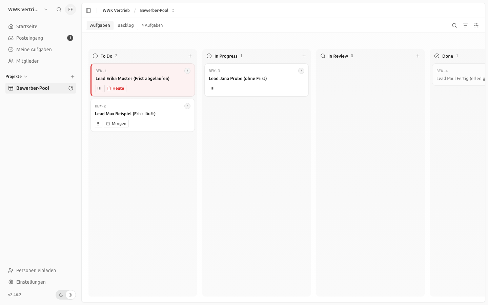
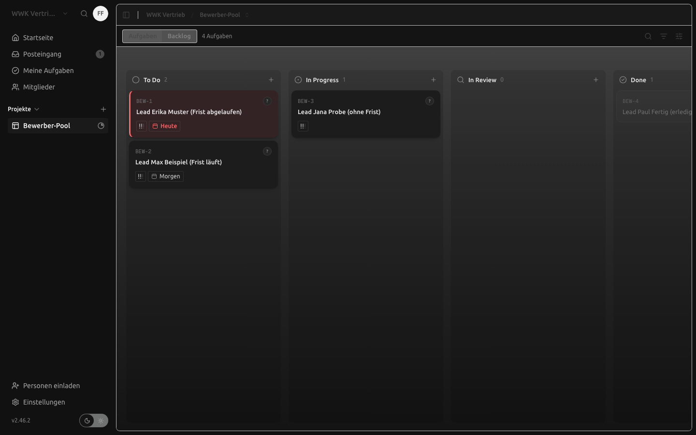
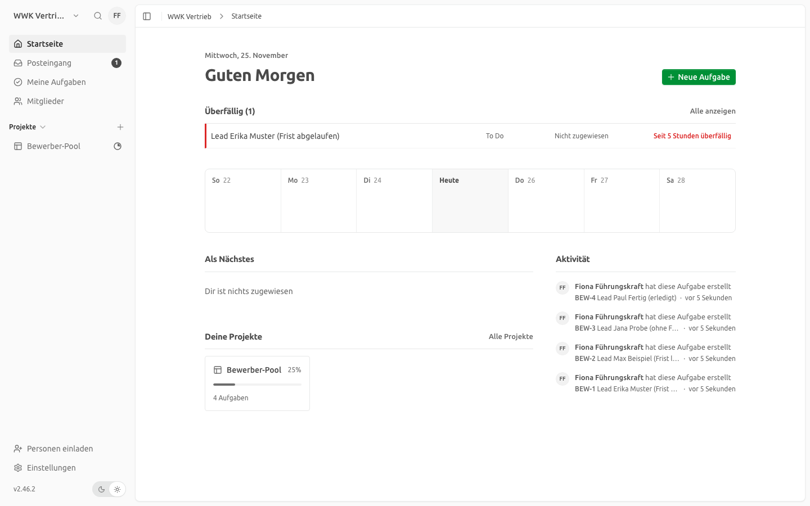
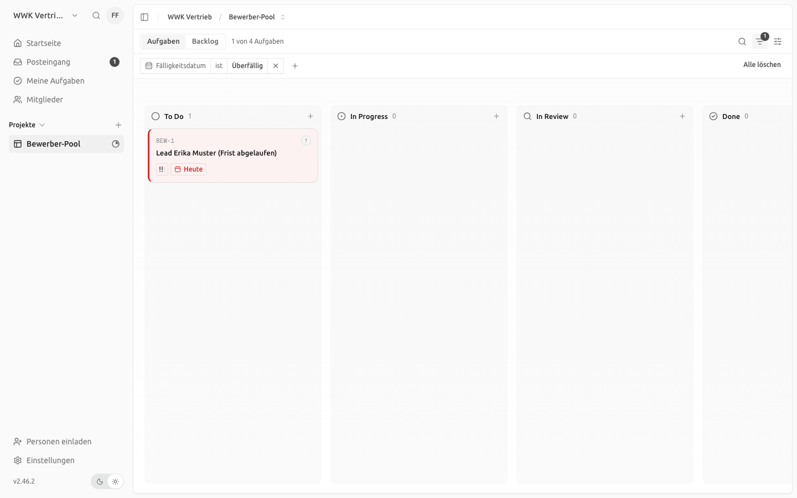

# Frist je Lead sichtbar — Board-Teil, Umsetzung und Nachweis

| | |
|---|---|
| **Story** | PEGA-66: Ein freigegebener Lead kommt in „Unbearbeitet“. Die zuständige Führungskraft hat dann 24 Stunden bis zur Erinnerung und 48 Stunden bis zum Fristende. Der Hub führt die Frist und setzt sie als Fälligkeit der Karte. Hier: der **Board-Teil**, also die Anzeige: überfällige Karten rot, Filter „Überfällig“, Block „Überfällig (n)“ auf der Startseite. |
| **Bezug** | Hub-Teil: `pegasus-hub` Branch `th_PEGA-66`, `docs/BENACHRICHTIGUNGEN.md` „Fristen“, `docs/BOARD.md`; Vorgänger [Benachrichtigungen im Hub (PEGA-80)](2026-11-benachrichtigungen-integrationen.md), [Sichtbereich nach Einheiten (PEGA-141)](2026-11-sichtbereich-einheiten.md); [Register der Fork-Eingriffe](../fork-eingriffe.md#pega-66--frist-je-lead-sichtbar-board-teil) |
| **Stand** | 2026-11-25, Fork `IAMDS-GMBH/pegasus-board`, Branch `th_PEGA-66` auf Basis `th_PEGA-80` @ `c2110381` |
| **Autor** | IAMDS |

Pfadangaben beziehen sich auf die Repo-Wurzel.

---

## 0. Ergebnis auf einer Seite

| Abnahmekriterium | Befund im Board |
|---|---|
| Vertrag mit dem Hub: `PUT /task/due-date/{id}` (`updateTaskDueDate`) setzt mit `{ "dueDate": … }` und entfernt mit `{}`; `GET /task/{id}` liefert `dueDate`; Systemkonto wird weder von der Spaltensperre noch von `LEAD_EDIT` aufgehalten | **Erfüllt ohne Code-Änderung.** Test mit dem API-Schlüssel des Systemkontos auf einer Karte in einer gesperrten Spalte und auf einer Karte, für die eine Führungskraft ohne `LEAD_EDIT` 403 `MISSING_PERMISSION` bekommt. Siehe Befund 1. |
| Überfällige Karte rot, nicht nur der Chip; erledigte (Spalte `isFinal`) nicht | **Erfüllt.** Kanban-Karte, Listen- und Backlog-Zeile mit rotem linken Rand und Tönung (hell und dunkel), für Screenreader „Überfällig“. Die Karte gibt `isCompleted` an den Chip weiter. Eine offene Karte wird rot, sobald die Frist abläuft, ohne Neuladen. |
| Eine Regel `isTaskOverdue` für Karte, Liste und Chip | **Erfüllt.** `apps/web/src/lib/is-task-overdue.ts`: Fälligkeit vor jetzt, Spalte nicht final, nicht archiviert. Siehe Entscheidung 1. |
| Filter „Überfällig“ in Board und Liste, bleibt erhalten wie die übrigen Fälligkeitsfilter | **Erfüllt.** Wert `overdue` in `DUE_DATE_FILTER_VALUES` und `DUE_DATE_OPTIONS`, „Überfällig“ / „Overdue“. Wie alle Board-Filter je Projekt im Browser gespeichert, nicht in der URL. Siehe Befund 2. |
| `GET /task/overdue` (`listOverdueTasks`) über den Sichtbereich: `all` alle, `units` die Karten der Einheiten, `assigned` die eigenen; ungesteuerte Mitglieder alle; älteste zuerst, höchstens 100 plus `total`, `countOnly` | **Erfüllt.** Dieselbe Sichtprüfung wie Board-Liste und Suche (`taskVisibleCondition`), dazu der Projektzugriff. Test je Nutzer des Testbaums. |
| Startseite: Block „Überfällig (n)“ nur bei `total > 0`; Zeile mit Titel, Spalte, Assignee, Dauer; Klick öffnet die Karte; „alle anzeigen“ zum Board mit Filter | **Erfüllt.** Die zehn ältesten Karten; bei mehr ein Hinweis „Die 10 ältesten von n“. „Alle anzeigen“ je Projekt mit überfälligen Karten (Entscheidung 3). |
| Posteingang (Glocke) unverändert, keine Board-Mails | **Erfüllt.** Scheduler und Benachrichtigungstypen unverändert; siehe Befund 3 zur Zeit des nativen `task_overdue`. |
| Posteingang nach dem Wegfall der Board-Einstellungen (PEGA-156): Zuweisung, neue Karte mit Assignee, Kommentar, Erwähnung, Statuswechsel erreichen den Assignee | **Erfüllt** für Nutzer ohne gespeicherte Abwahl (Test je Art). Alte Abwahlen bewusst nicht behandelt (Entscheidung 2). |

**Befund 1: Der Vertrag hält ohne Änderung.** Die Route hängt an `workspaceAccess.fromTask()`, `requireLeadPermission({ task: ["update"] }, "LEAD_EDIT")` und `requireEntitlement`, ohne `requireTaskColumnUnlocked`. Das Systemkonto ist über `isHubSystemAccount` in `loadMemberAccess` ungesteuert; `requireLeadPermission` fällt für es auf die Kaneo-Rolle (`task:update`) und den Scope des API-Schlüssels zurück, wie bei `updateTaskAssignee` und `updateTaskStatus`. `{}` entfernt die Fälligkeit (`dueDate = null`); `{ "dueDate": null }` wäre 400, weil das Feld ein optionaler String ist. `requireEntitlement` kennt keine Ausnahme für den Hub, wirkt aber nur mit aktivierter Abrechnung (im Self-Hosting aus) und gilt genauso für die Routen, die der Hub schon nutzt.

**Befund 2: Board-Filter stehen nicht in der URL.** Die Aufgabe nimmt an, dass Fälligkeitsfilter in der URL bleiben. Tatsächlich speichert das Board alle Filter je Projekt im `localStorage` (`kaneo:board-filters:<projectId>`); die Board-URL trägt nur `taskId`. Damit „alle anzeigen“ trotzdem gefiltert öffnet, nimmt die Board-Route `?filter=overdue` an, setzt damit den Fälligkeitsfilter (andere Filter bleiben, eine Negation der Fälligkeit wird aufgehoben) und entfernt den Parameter wieder aus der Adresse.

**Befund 3: Der native Eintrag `task_overdue` kommt bei einer Hub-Frist 24 Stunden zu spät.** Upstream liest eine Fälligkeit als ganzen Tag (`DUE_DATE_DURATION_MS`, Datumsauswahl speichert lokal 00:00): `task_overdue` kommt bei Fälligkeit + 24 h, `due_date_reminder` mit dem Standardvorlauf von 1.440 Minuten genau bei der Fälligkeit. Mit der minutengenauen Hub-Frist heißt das: „Fällig“ im Posteingang erscheint zum Fristende, „Überfällig“ einen Tag später. Die Aufgabe verlangt den Scheduler unverändert; er bleibt so. Für „Nur im Board“ ist die rote Karte und der Startseiten-Block der rechtzeitige Hinweis.

**Entscheidung 1: Maßgeblich ist der Zeitpunkt, nicht der Kalendertag.** Die Hub-Frist endet zu einer bestimmten Minute. Karte, Liste, Chip, Filter und `/task/overdue` werten deshalb `dueDate < jetzt`. Upstream rechnet sonst in Kalendertagen (Chip-Text, „Meine Aufgaben“, Mobile). Folge: Eine von Hand auf „heute“ datierte Karte (lokal 00:00) ist den ganzen Tag rot, ihr Chip zeigt weiter „Heute“. Für Hub-Fristen ist das richtig; Karten mit selbst gesetzten Daten gibt es im Bewerber-Pool kaum.

**Entscheidung 2: Alte Abwahlen im Posteingang bleiben unbehandelt.** `createNotification` wertet weiter `user_notification_preference` aus (`taskAssignmentEnabled`, `taskCommentEnabled`, `taskStatusChangeEnabled`, `dueDateReminderEnabled`). Seit PEGA-80 kann niemand diese Schalter mehr ändern. Es gibt noch keine Produktivnutzer; Abwahlen können nur Testnutzer gespeichert haben. Deshalb weder Code-Änderung noch Migration. Zeigen sich vor dem Livegang echte Abwahlen, setzt eine Fork-Migration die vier Spalten auf `true`. Festgehalten im [Register](../fork-eingriffe.md#pega-66--frist-je-lead-sichtbar-board-teil).

**Entscheidung 3: Der Block zeigt sich jedem, der überfällige Karten sieht.** Das Web weiß nicht, wer Führungskraft ist, und muss es nicht: Der Sichtbereich kommt aus der API. Eine Führungskraft sieht ihre Einheiten, ein Bearbeiter (`assigned`) nur seine eigenen überfälligen Karten, wer keine hat, sieht nichts. Weil überfällige Karten in mehreren Projekten liegen können und es kein projektübergreifendes Board gibt, führt „Alle anzeigen“ je Projekt aufs gefilterte Board; im Regelfall (ein Bewerber-Pool je Workspace) ist es ein Link.

---

## 1. Verhalten

### Überfällig

| Karte | Rot, im Filter, im Block |
|---|---|
| Fälligkeit vor jetzt, Spalte offen | ja |
| Fälligkeit später (auch heute später) | nein |
| keine Fälligkeit | nein |
| Spalte `isFinal` (z. B. erledigt) | nein |
| archiviert | nein |
| Projekt archiviert | nicht im Block (Board nicht erreichbar) |

### `GET /task/overdue` im Testbaum

Überfällig sind L2 (U3, dem Bearbeiter zugewiesen), L6 (U8), M1 (V3) und N0 (ohne Einheit). L1 (künftig), L3 (ohne Fälligkeit), L4 (finale Spalte), L5 (archiviert) und eine Karte in einem archivierten Projekt nicht.

| Nutzer | Modus | Antwort |
|---|---|---|
| Owner | ungesteuert | N0, M1, L6, L2 (älteste zuerst), `total` 4 |
| Führungskraft BD | `units` [U3] | L2 |
| Führungskraft FD | `units` [U2, U3, U4] | L2 |
| Mehrere BD | `units` [U3, U6, U8] | L2, L6; mit `countOnly=true` `{ tasks: [], total: 2 }` |
| Alle | `all` | L2, L6, M1, N0 |
| Bearbeiter | `assigned` | L2 |
| ohne Stand im Hub | — | nichts |
| fremder Workspace | — | 404 |

---

## 2. Umsetzung

- API: `task/controllers/get-overdue-tasks.ts` und `task/overdue-tasks-schema.ts` (neu), Route `listOverdueTasks` in `task/index.ts` vor den `/{id}`-Routen; `apps/docs/openapi.json`. Upstream-Controller `get-assigned-tasks.ts` unberührt.
- Web, Regel: `lib/is-task-overdue.ts`, `lib/minute-clock.ts` (ein gemeinsamer Minutentakt, nur solange Karten mit laufender Fälligkeit sichtbar sind), `hooks/use-is-task-overdue.ts` (`useSyncExternalStore`, rendert nur Karten neu, deren Zustand kippt).
- Web, Anzeige: `task-chips/due-date-chip.tsx`, `kanban-board/task-card/task-card-content.tsx`, `list-view/task-row-body.tsx` (gilt für Liste und Backlog); Tokens `--due-overdue-bg` (Zeile, durchscheinend) und `--due-overdue-card` (Karte, deckend) in `index.css`, hell und dunkel.
- Web, Filter: `hooks/use-task-filters.ts`, `lib/task-filters/{due-date-options,task-matches-filters}.ts` (`isFinalStatus` im Kontext), `hooks/use-task-filters-with-labels-support.ts`, `hooks/use-overdue-filter-from-search.ts`, Board-Route (`?filter=overdue`).
- Web, Startseite: `fetchers/task/get-overdue-tasks.ts`, `hooks/queries/task/use-get-overdue-tasks.ts` (30 Sekunden wie „Als Nächstes“), `components/home/{overdue-block,overdue-task-row,overdue-since}.ts(x)`, Route `workspace/$workspaceId/index.tsx`; Invalidierung in `lib/invalidate-my-work.ts` und bei `PROJECT_ACCESS_CHANGED`.
- i18n: `tasks.due.overdue`, `tasks.backlog.filters.overdue`, `workspace.home.overdue.*` (en-US, de-DE; übrige Locales englisch über `pnpm i18n:check:fix`), `i18n/schema.json` von Hand.
- Doku: `docs/fork-eingriffe.md`, dieses Review.

---

## 3. Grenzen und Folgearbeiten

- Mobile-App: Filter „Nur überfällig“ zählt weiter nach Kalendertag, Karten sind nicht markiert.
- Der Filter „Überfällig“ wertet beim Rendern des Boards aus; eine Karte, deren Frist bei offenem Board abläuft, wird sofort rot, rutscht aber erst beim nächsten Neuberechnen (Änderung, Neuladen, Filterwechsel) in die gefilterte Ansicht.
- `task_overdue` im Posteingang 24 Stunden nach Fristende (Befund 3).
- Alte Abwahlen leeren den Posteingang weiter still (Entscheidung 2).

---

## 4. Gelaufen

Testgetrieben: je Verhalten zuerst der fehlschlagende Test, dann der Code. Die Prüfungen des Hub-Vertrags und des Posteingangs belegen bestehendes Verhalten und waren sofort grün.

| Verhalten | Rot | Grün |
|---|---|---|
| Hub setzt und entfernt die Fälligkeit trotz Sperre und ohne `LEAD_EDIT` (`hub-due-date.test.ts`) | — (Verhalten bestand) | 2/2 |
| `listOverdueTasks` je Modus, Kriterien, `countOnly`, 404 (`overdue-tasks.test.ts`) | 404 „Task not found“ (Route fehlte, `/{id}` griff) | 9/9 |
| Posteingang je Art (`notification-inbox-types.test.ts`) | — (Verhalten bestand) | 5/5 |
| `isTaskOverdue` (`is-task-overdue.test.ts`) | Modul fehlt | 6/6 |
| Minutentakt (`use-is-task-overdue.test.tsx`) | Modul fehlt | 3/3 |
| Kanban-Karte markiert, nicht in finaler Spalte (`task-card.test.tsx`) | „Unable to find … tasks:due.overdue“ | 12/12 |
| Chip rot nach abgelaufener Minute am selben Tag (`due-date-chip.test.tsx`) | Klasse `text-due-overdue` fehlt | 2/2 |
| Listen- und Backlog-Zeile markiert (`task-row.test.tsx`) | „Unable to find … tasks:due.overdue“ | 16/16 |
| Filter `overdue` im Matcher (`task-matches-filters.test.ts`) | `expected false to be true` | 44/44 |
| Filter überspringt finale Spalten mit eigenem Slug (`use-task-filters-with-labels-support.test.tsx`) | `[ 'late', 'taken' ]` statt `[ 'late' ]` | 8/8 |
| `?filter=overdue` (`use-overdue-filter-from-search.test.tsx`) | Modul fehlt | 2/2 |
| Dauer „seit …“ (`overdue-since.test.ts`) | Modul fehlt | 6/6 |
| Startseiten-Block (`overdue-block.test.tsx`) | Modul fehlt | 4/4 |

Gesamtläufe am 2026-11-25:

- `pnpm lint`: 4.122 Dateien formatiert, keine Lint-Fehler.
- `pnpm typecheck`: grün.
- `pnpm openapi:check`: aktuell (nach `openapi:check:fix`; neue Operation `listOverdueTasks` mit den Schemas `OverdueTasks`, `OverdueTask`).
- `pnpm i18n:check`: alle Locales synchron.
- `pnpm test`: alle Pakete grün (u. a. API-Unit 1.313, Web 1.835 Tests).
- `pnpm test:integration`: 174 Dateien, 2.019 bestanden, 3 übersprungen.

Browser-Nachweis (Playwright, Chromium, `de-DE`) gegen den e2e-Stack (`docker compose -f tests/e2e/compose.yml up --build --wait`, danach `down`): Projekt „Bewerber-Pool“ mit vier Karten, Fälligkeit vor 5 Stunden (offen), in 30 Stunden, ohne, und vor 50 Stunden in „Done“.

- Board: genau eine Karte markiert (`[data-overdue]`), die erledigte nicht; hell und dunkel lesbar.
- Startseite: „Überfällig (1)“, Zeile „Lead Erika Muster … · To Do · Nicht zugewiesen · Seit 5 Stunden überfällig“.
- „Alle anzeigen“: Board ohne Parameter in der Adresse, Filter „Fälligkeitsdatum ist Überfällig“ gesetzt, „1 von 4 Aufgaben“, nur die überfällige Karte sichtbar.

| Board hell | Board dunkel |
|---|---|
|  |  |

| Startseite | Board nach „Alle anzeigen“ |
|---|---|
|  |  |
