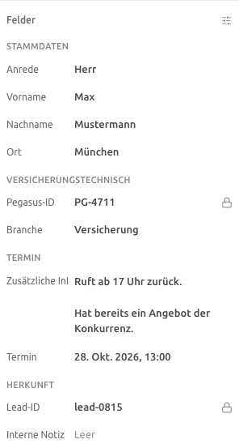
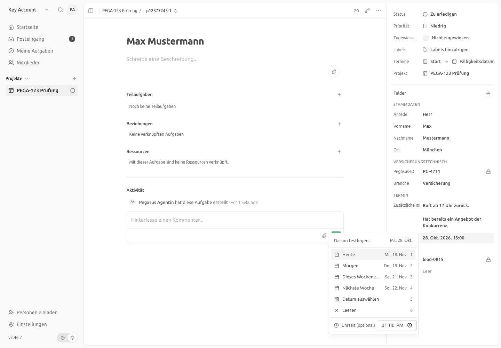
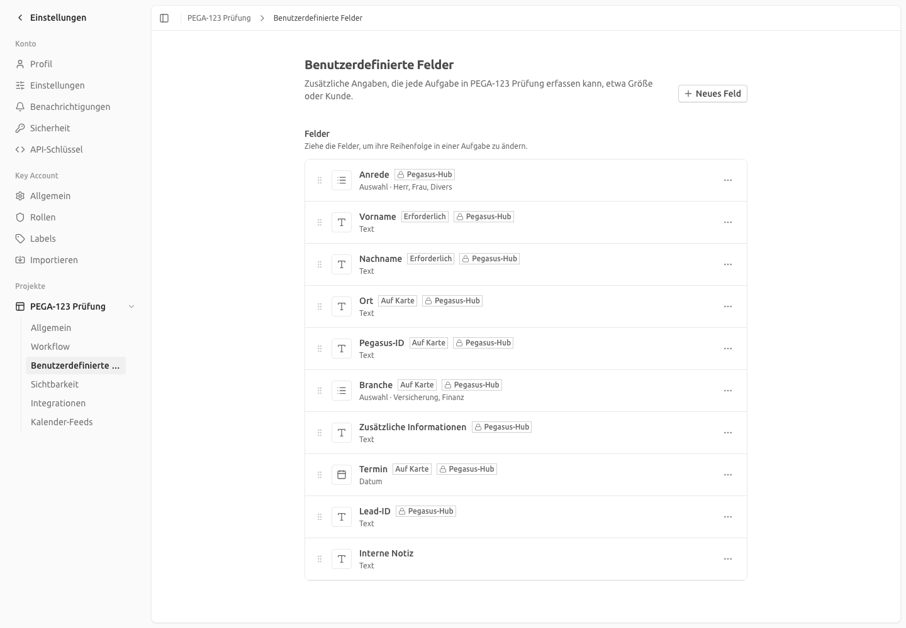
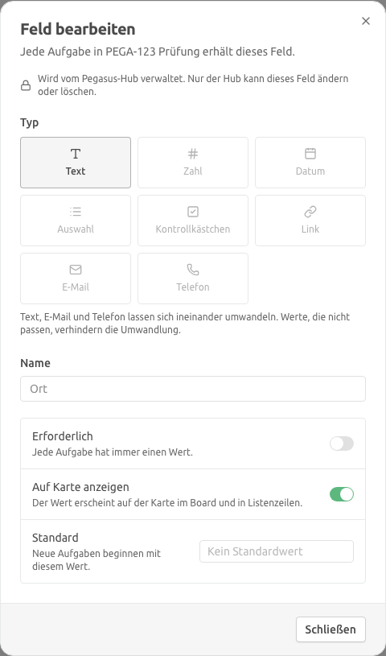

# Felder des Pegasus-Termins — Board-Teil, Umsetzung und Nachweis

| | |
|---|---|
| **Story** | PEGA-123: Führungskräfte finden auf der Karte alles, was Pegasus heute im qualifizierten Termin per Mail schickt. Der Pegasus-Hub legt die Felder im Projekt „Bewerber-Pool“ an und füllt sie aus dem Lead; das Board gruppiert sie, schützt die Felder des Hubs, zeigt den Termin mit Uhrzeit, lässt Notizen mehrzeilig zu und meldet jede Wertänderung sofort. Hier: der **Board-Teil** |
| **Bezug** | Hub-Teil: `pegasus-hub` Branch `th_PEGA-123` (`bewerber-pool.template.ts`, `docs/BOARD.md` „Felder der Karte (Pegasus-Termin)“); [Register der Fork-Eingriffe](../fork-eingriffe.md#pega-123--felder-des-pegasus-termins); [Board-Einrichtung](../board-einrichtung.md#3-was-eingerichtet-wird) |
| **Stand** | 2026-11-18, Fork `IAMDS-GMBH/pegasus-board`, Branch `th_PEGA-123` auf Basis `main` @ `16793b37` |
| **Autor** | IAMDS |

Pfadangaben beziehen sich auf die Repo-Wurzel.

---

## 0. Ergebnis auf einer Seite

| Abnahmekriterium | Befund im Board |
|---|---|
| Felddefinitionen tragen `section`, `hubDefined`, `hubManaged` (anlegen, ändern, lesen; an den Werten `fieldSection`, `fieldHubDefined`, `fieldHubManaged`) | **Erfüllt.** Migration `0068_custom_field_hub_properties.sql`, Zod- und OpenAPI-Schemas, `apps/docs/openapi.json`. |
| Definition eines Hub-Felds ändert oder löscht nur das Systemkonto; sonst 403 `HUB_DEFINED_FIELD` mit `fields` | **Erfüllt** für jede Eigenschaft (Name, Typ, Auswahlwerte, Pflicht, Standardwert, `showOnCard`, `section`, Flags) und für Löschen, gegen Workspace-Admin, Owner und Instanz-Admin geprüft. Anlegen mit einem Flag ebenso. Umsortieren bleibt erlaubt. |
| Wert eines `hubManaged`-Felds setzt nur das Systemkonto; sonst 403 `HUB_MANAGED_FIELD` | **Erfüllt** auf allen Wegen, die Werte schreiben: `setCustomFieldValue` (setzen und leeren) und `createTask`. `duplicateTask` legt das Duplikat ohne diese Werte an. Siehe Entscheidung 1 zu `updateTask`, `bulkUpdateTasks`, `importTasks`. |
| `required` ohne Standardwert; Leeren abgewiesen | **Erfüllt.** Ohne Standardwert nur, solange keine Karte ohne Wert ist (400 `CUSTOM_FIELD_REQUIRED_MISSING_VALUES`); Leeren 400 `CUSTOM_FIELD_VALUE_REQUIRED`; neue Karte ohne Pflichtwert 400 (wie bisher), das Formular verlangt die Felder. |
| Detailansicht nach `section` gruppiert, Stammdaten getrennt von den versicherungstechnischen Daten | **Erfüllt.** Überschrift je Gruppe, Gruppen in der Reihenfolge ihres ersten Felds, Felder ohne Gruppe am Ende ohne Überschrift. Kartenvorschau unverändert ohne Gruppen. |
| Termin mit Uhrzeit (Europe/Berlin), Datumsauswahl mit optionaler Uhrzeit, kein neuer Typ | **Erfüllt.** Gespeichert unverändert als UTC ISO 8601 (`2026-10-28T12:00:00.000Z` → „28. Okt. 2026, 13:00“). |
| Mehrzeiliger Text | **Erfüllt.** Anzeige mit Umbrüchen in der Detailansicht, Bearbeiten im Textfeld (Enter neue Zeile, Strg/⌘+Enter speichert). |
| Webhook `task.custom_field_changed` je geändertem Wert, mit altem und neuem Wert, auch für das Systemkonto, nicht bei gleichem Wert, nicht beim Anlegen | **Erfüllt** (Schalter `taskCustomFieldChanged`, standardmäßig aus). |
| Texte in de-DE und en-US | **Erfüllt**; übrige Locales englisch. |

**Entscheidung 1: Nur echte Schreibwege werden geschützt.** Die Aufgabe nennt auch `updateTask`, `bulkUpdateTasks` und `importTasks`. Keiner dieser Wege nimmt im Board Feldwerte an (kein `customFields` im Body, keine Bulk-Operation für Felder); der Hub schreibt Werte nur über `POST /task` und `PUT /custom-field/value`. Mit dem Product Owner abgestimmt: Sperre und Webhook sitzen an `setCustomFieldValue`, `createTask` und `duplicateTask`; ein Test hält fest, dass ein `customFields` an den drei anderen Wegen ignoriert wird. Bekommt einer davon von Upstream Feldwerte, schlägt der Test an (Register, „Beim Sync beachten“).

**Entscheidung 2: Pflicht ohne Standardwert nur ohne Lücken.** Ein Pflichtfeld ohne Standardwert kann bestehende Karten nicht auffüllen. Die API nimmt es deshalb nur an, solange jede Karte des Projekts einen Wert hat (beim Anlegen: solange das Projekt keine Karten hat). Für ein bestehendes Projekt legt der Hub das Feld zuerst ohne Pflicht an, füllt die Werte und setzt dann `required` per `PUT`.

**Entscheidung 3: Board-Skript lässt Hub-Felder aus.** Das Skript aus PEGA-84 pflegt Standardfelder mit denselben Namen (Telefon, Ort, Quelle, Paket …). Sobald der Hub ein Feld als seines markiert, bekäme das Skript 403 und würde die Reihenfolge des Hubs (und damit die Gruppen) umwerfen. `scripts/board-setup/plan-fields.mjs` ändert solche Felder nicht mehr und lässt sie in der Reihenfolge aus.

---

## 1. Verhalten

| Thema | Verhalten |
|---|---|
| Wer ist „der Hub“ | Nur das Konto mit der Nutzer-ID aus `PEGASUS_HUB_USER_ID` (`isHubSystemAccount`). Owner, Instanz-Admins und Workspace-Admins sind es nicht. |
| `section` | Freier Text bis 100 Zeichen; leer oder `null` = keine Gruppe. Keine feste Liste (der Hub schickt `Stammdaten`, `Versicherungstechnisch`, `Termin`, `Herkunft`). |
| `hubDefined` | `PUT` (jede Eigenschaft) und `DELETE` nur durch den Hub; ein Feld mit einem Flag anlegen oder ein Board-Feld dazu machen ebenfalls. 403 `{ "code": "HUB_DEFINED_FIELD", "fields": ["Gesellschaft"] }`. `PUT /custom-field/reorder/{projectId}` bleibt für alle mit `project:update`. |
| `hubManaged` | Wert setzen, ändern, leeren nur durch den Hub: 403 `{ "code": "HUB_MANAGED_FIELD", "fields": ["Lead-ID"] }`. `createTask`: 403, wenn ein nicht leerer Wert ein solches Feld trifft (Standardwerte des Servers zählen nicht). Duplikat ohne diese Werte, für jeden. |
| `required` | Ohne Standardwert erlaubt, solange keine Karte ohne Wert ist (sonst 400 `CUSTOM_FIELD_REQUIRED_MISSING_VALUES`). Leeren: 400 `CUSTOM_FIELD_VALUE_REQUIRED`. Der Code `CUSTOM_FIELD_DEFAULT_REQUIRED` entfällt. |
| Webhook | `task.custom_field_changed`, Umschlag wie die übrigen Ereignisse, `data: { fieldId, fieldName, fieldType, oldValue, newValue }`, leer = `null`. Der alte Wert wird unter Zeilensperre gelesen. Die Live-Aktualisierung (`task.updated` mit `customFieldsChanged`) bleibt unverändert. |
| Anzeige | Detailansicht gruppiert; Wert eines `hubManaged`-Felds schreibgeschützt mit Schloss und Hinweis „Wird vom Pegasus-Hub gesetzt“ (auch in den Chips der schmalen Ansicht); Formular „Neue Karte“ bietet diese Felder nicht an. Projekteinstellungen: Hub-Felder mit Abzeichen „Pegasus-Hub“, ohne Löschen; der Dialog ist nur lesbar („Wird vom Pegasus-Hub verwaltet“, nur „Schließen“). |
| Datum | Wert mit Uhrzeit (`T…`): Anzeige Datum und Uhrzeit in Europe/Berlin, unabhängig von der Zeitzone des Browsers; Bearbeiten: Tag wählen, Uhrzeit optional (Enter übernimmt), gespeichert als UTC. Ohne Uhrzeit wie bisher `YYYY-MM-DD`. |
| Text | Mehrzeilig bearbeiten; Detailansicht mit Umbrüchen; Kartenvorschau einzeilig. |

---

## 2. Umsetzung

| Datei | Aufgabe |
|---|---|
| `apps/api/drizzle/0068_custom_field_hub_properties.sql`, `database/schema.ts` | Spalten `section text`, `hub_defined`/`hub_managed boolean not null default false`, idempotent (`ADD COLUMN IF NOT EXISTS`). |
| `apps/api/src/custom-field/hub-field-guard.ts` (**neu**) | `assertMayChangeDefinition`, `assertMaySetValues` (403 mit `fields`). |
| `apps/api/src/custom-field/assert-every-task-has-value.ts` (**neu**) | Prüfung „keine Karte ohne Wert“ für Pflicht ohne Standardwert. |
| `custom-field/{schema,response,field-error,assert-valid-definition,resolve-field-update,index}.ts`, `controllers/*` | Eigenschaften, Fehlercodes, Nutzer-ID an die Controller, Webhook-Ereignis in `set-custom-field-value.ts`. |
| `task/controllers/{create-task,duplicate-task}.ts` | Sperre beim Anlegen, Duplikat ohne `hubManaged`-Werte. |
| `errors/{api-error,api-error-schema,http-exception-response}.ts` | Fehlerkörper um `fields` erweitert. |
| `plugins/{types,registry}.ts`, `plugins/generic-webhook/{config,events,index}.ts`, `integrations/{schema,response}.ts` | Ereignis und Schalter `taskCustomFieldChanged`. |
| Web `components/task/custom-fields/`, `components/custom-fields/`, `components/project/custom-fields/`, `shared/modals/create-task-modal.tsx`, `project/integrations/generic-webhook/`, `fetchers/generic-webhook-integration/` | Gruppen, Schloss, Datum mit Uhrzeit (`custom-field-date.ts`, Intl statt Zeitzonen-Bibliothek), mehrzeiliger Text, nur lesbarer Feld-Dialog, Webhook-Schalter. |
| `scripts/board-setup/plan-fields.mjs` | Hub-Felder auslassen. |
| `i18n/*.json`, `i18n/schema.json` | neue Schlüssel (Register), `defaultRequired` entfernt. |
| `apps/docs/openapi.json`, `apps/docs/core/integrations/outgoing-webhooks.mdx`, `docs/fork-eingriffe.md`, `docs/board-einrichtung.md` | Vertrag und Doku. |

---

## 3. Umgehungsmöglichkeiten und offene Punkte

| # | Fläche | Status |
|---|---|---|
| 1 | Owner, Instanz-Admin oder Workspace-Admin ändern Hub-Felder oder Hub-Werte | **gedeckt**: 403 für jeden außer `PEGASUS_HUB_USER_ID` (Tests je Rolle) |
| 2 | Board-Feld nachträglich zum Hub-Feld machen, um es zu sperren | **gedeckt**: Flags setzen nur der Hub |
| 3 | Lead-ID über ein Duplikat auf eine zweite Karte bringen | **gedeckt**: Duplikat ohne `hubManaged`-Werte |
| 4 | `updateTask`, `bulkUpdateTasks`, `importTasks` | **kein Schreibweg** (Entscheidung 1), per Test festgehalten |
| 5 | Import (`importTasks`) und Issue-Importe legen Karten ohne Pflichtwerte an | **offen, akzeptiert**: Diese Wege kennen keine Feldwerte und prüfen Pflichtfelder auch heute nicht. Im Bewerber-Pool legt der Hub die Karten an. |
| 6 | Mobile App | **offen**: zeigt Hub-Werte noch bearbeitbar und Termine ohne Uhrzeit; die API weist Änderungen mit 403 ab. |
| 7 | Hub legt `Vorname`/`Nachname` in einem Projekt mit Karten an | **Hub**: zuerst ohne Pflicht anlegen, füllen, dann `required` setzen (Entscheidung 2). |
| 8 | Webhook für Werte, die beim Anlegen einer Karte gesetzt werden | **gewollt**: deckt `task.created` |

---

## 4. Nachweis

Test-first je Verhalten (rot → grün → refactor). Rot gesehen (Auszug):

- Eigenschaften: Antwort ohne `section`/`hubDefined`/`hubManaged` (`expected { …(11) } to match object { section: 'Herkunft', …(2) }`); `PUT` des Hubs ließ sie unverändert (`"hubDefined": false`); Werte ohne `fieldSection` (Selects kurz ausgehängt, da im ersten Grün mitgekommen).
- Definition sperren: 13 von 19 rot, jeweils `expected 200 to be 403` (Anlegen, jede Eigenschaft, Flags setzen, Löschen).
- Werte sperren: setzen/leeren als Mitglied, Admin, Owner, Instanz-Admin `expected 200 to be 403`; neue Karte mit Lead-ID `expected 200 to be 403`; Duplikat `expected { 'Lead-ID': 'lead-1', Ort: 'Bonn' } to deeply equal { Ort: 'Bonn' }`.
- Pflicht: `CUSTOM_FIELD_DEFAULT_REQUIRED` statt Anlegen (`expected 400 to be 200`), statt `CUSTOM_FIELD_REQUIRED_MISSING_VALUES`; Leeren ohne Code (`"code": "BAD_REQUEST"`). Abschnitt mit leerer Gruppe: `expected '' to be null`.
- Webhook: `handleTaskCustomFieldChanged is not a function`, Schalter `expected undefined to be false`, keine Zustellung (`expected [] to have a length of 1 but got +0`), Schalter im `PATCH` verworfen. „Keine Zustellung bei gleichem Wert“ mit kurz ausgehängter Prüfung rot gesehen (`expected [ { …(8) } ] to deeply equal []`).
- Web: keine Überschriften (`Unable to find an accessible element with the role "heading"`), Hub-Wert bearbeitbar (`toBeDisabled()`), Datum ohne Uhrzeit (`expected 'Oct 28, 2026' to match /13:00|1:00\sPM/`), keine Uhrzeit-Eingabe, Text als `INPUT` statt `TEXTAREA`, Lead-ID im Formular „Neue Karte“, Fehlercodes ohne Text, Hub-Feld im Dialog bearbeitbar und löschbar, kein Webhook-Schalter.
- Board-Skript: Hub-Felder geändert und umsortiert (2 von 2 rot).
- Im Browser gefunden: Im nur lesbaren Feld-Dialog ließ sich „Auf Karte anzeigen“ trotz `<fieldset disabled>` umschalten (Base-UI-Schalter beachten das native `disabled` des Fieldsets nicht). Test „does not toggle the switches of a Hub field“ rot (`expected 'true' to be 'false'`), dann `disabled` an Schalter und Typauswahl, `inert` für die übrigen Auswahlen. Speichern war ohnehin nicht möglich (kein Speichern-Knopf, API 403).

Tests:

- `tests/api-integration/custom-field-hub-properties.test.ts` (**neu**, 29): Eigenschaften anlegen, ändern, lesen; Definition je Eigenschaft und je Rolle; Löschen; Umsortieren; Board-Felder; Werte je Rolle und Weg; Duplikat; `updateTask`/Bulk/Import schreiben keine Werte.
- `tests/api-integration/custom-field-required.test.ts` (**neu**, 5): Pflicht ohne Standardwert, Ablehnung mit Karten, neue Karte ohne Wert, Leeren, Datum mit Uhrzeit unverändert gespeichert.
- `tests/api-integration/custom-field-changed-webhook.test.ts` (**neu**, 6): echter Ereignisbus und Plugin-Registry, Zustellung gemockt; je Änderung genau ein Ereignis mit altem und neuem Wert, Leeren, gleicher Wert, Systemkonto als Akteur, kein Ereignis beim Anlegen, Schalter in den Webhook-Einstellungen.
- `tests/api/plugins/generic-webhook/events.test.ts` (+2), `config-reminders.test.ts` (+1), `tests/api/custom-field/resolve-field-update.test.ts` (+1).
- Web **neu:** `group-fields-by-section.test.ts`, `task-custom-field-rows.test.tsx`, `custom-field-date.test.ts` (auch Sommerzeit und Tageswechsel), `date-field-editor.test.tsx`, `text-field-editor.test.tsx`, `generic-webhook-events.test.ts`; **ergänzt:** `custom-field-row.test.tsx`, `custom-field-chip.test.tsx`, `format-custom-field-value.test.ts`, `create-task-modal.test.tsx`, `custom-field-dialog.test.tsx`, `custom-field-list.test.tsx`, `custom-field-error-key.test.ts`.
- `scripts/board-setup/plan-fields.test.mjs` (+2).

**Offen geänderte bestehende Tests** (die Regel „Pflicht braucht einen Standardwert“ entfällt mit der Story, alte Fassung jeweils rot gesehen):
- `custom-field-error-codes.test.ts`: Fall `CUSTOM_FIELD_DEFAULT_REQUIRED` ersetzt durch `CUSTOM_FIELD_REQUIRED_MISSING_VALUES` (Karte ohne Wert).
- `custom-field-update.test.ts`: „rejects making a field required without a default“ → „…while a task has no value“; neu „makes a field required without a default when every task has a value“.
- `custom-field.test.ts`: „rejects a required field without a default value“ → „creates …“; bei Mehrfachauswahl ist `[]` als Standardwert eines Pflichtfelds kein Fehler mehr.
- `custom-field-live-updates.test.ts`: Die genaue Liste der Ereignisse enthält jetzt je Wertänderung `task.custom_field_changed`.
- `resolve-field-update.test.ts`: „requires one for required fields“ → „clears the default with null, also for required fields“; Fixture um die neuen Eigenschaften ergänzt.
- Web: `field-form.test.ts` und `custom-field-dialog.test.tsx` (Pflicht ohne Standardwert erlaubt), `custom-field-error-key.test.ts` (`CUSTOM_FIELD_DEFAULT_REQUIRED` entfernt), `lib/i18n/custom-field-translations.test.ts` (Liste der Fehlertexte), `create-task-modal.test.tsx` (Text speichert mit Strg+Enter), `generic-webhook-integration-settings.test.tsx` (13 statt 12 Ereignisse).

Gelaufen: siehe Abschnitt 6.

---

## 5. Im Browser

Geprüft mit Playwright (Chromium, `locale: "de-DE"`) gegen den E2E-Stack aus `tests/e2e/compose.yml` (Port 18173, eigene Datenbank): Wegwerf-Projekt mit zehn Feldern wie in der Vorlage des Hubs, die Hub-Eigenschaften direkt in der Datenbank gesetzt (das Systemkonto meldet sich dort nicht an), Projekt danach gelöscht.

| Prüfung | Ergebnis |
|---|---|
| `PUT /custom-field/value` auf Lead-ID als Workspace-Owner | 403 `{"code":"HUB_MANAGED_FIELD","fields":["Lead-ID"]}` |
| `DELETE /custom-field/{id}` auf Ort als Workspace-Owner | 403 `{"code":"HUB_DEFINED_FIELD","fields":["Ort"]}` |
| Überschriften der Detailansicht | Stammdaten, Versicherungstechnisch, Termin, Herkunft; „Interne Notiz“ (ohne Gruppe) am Ende ohne Überschrift |
| Lead-ID | schreibgeschützt, Schloss, Hinweis „Wird vom Pegasus-Hub gesetzt“ |
| Termin `2026-10-28T12:00:00.000Z` | „28. Okt. 2026, 13:00“; Uhrzeit-Eingabe zeigt 13:00; 15:30 eingegeben → gespeichert `2026-10-28T14:30:00.000Z` |
| Zusätzliche Informationen | Anzeige mit Absatz; Bearbeiten im Textfeld, neue Zeile mit Enter, Speichern mit Strg+Enter, Umbrüche gespeichert |
| Projekteinstellungen | Abzeichen „Pegasus-Hub“, Menü nur „Bearbeiten“; Dialog mit Hinweis, Name und Typ gesperrt, Schalter unverändert nach Klick, nur „Schließen“ |

Die native Uhrzeit-Eingabe zeigt im Headless-Chromium „01:00 PM“, weil sie der Sprache des Browsers folgt, nicht der Seite; ein deutscher Browser zeigt 13:00.

---

## 6. Gelaufene Prüfungen

| Befehl | Ergebnis |
|---|---|
| `pnpm --filter @kaneo/api exec vp test run --config vitest.config.ts` | 172 Dateien, 1300 Tests grün |
| `pnpm --filter @kaneo/api exec vp test run --config vitest.integration.config.ts` (lokales PostgreSQL) | 171 Dateien, 1997 grün, 3 übersprungen (bestehend) |
| `pnpm --filter @kaneo/web exec vp test run --config vitest.config.ts` | 336 Dateien, 1793 Tests grün |
| `node --test scripts/board-setup/*.test.mjs` | 34 grün |
| `pnpm --filter @kaneo/api typecheck`, `pnpm --filter @kaneo/web typecheck` | ohne Fehler |
| `pnpm exec vp check <geänderte Dateien>` je Bereich (API, Web, Tests, Skript) | Formatierung und Lint ohne Befund |
| `pnpm openapi:check:fix`, danach `pnpm openapi:check` | `apps/docs/openapi.json` aktuell |
| `pnpm i18n:check:fix`, danach `pnpm i18n:check` | alle Locales in sync |
| Browser (Abschnitt 5) | wie beschrieben |

Die API-Suiten liefen vor der letzten Web-Korrektur (Schalter im Feld-Dialog); diese betraf nur die Web-App, deren Suite danach erneut lief.

---

## 7. Vertrag für den Hub

Nach dem Merge den Commit nennen, damit der Hub die Beschreibung zieht: `KANEO_REF=<commit> pnpm hub kaneo:spec:pull && pnpm hub kaneo:client:gen`. Danach schickt der Hub `section`, `hubDefined`, `hubManaged` und `required` beim Anlegen, gleicht sie an bestehenden Feldern ab (`PUT /custom-field/{id}`), übersetzt 403 `HUB_DEFINED_FIELD`/`HUB_MANAGED_FIELD` im Adapter und abonniert `task.custom_field_changed` (Schalter `taskCustomFieldChanged` beim Einrichten seines Webhooks).
