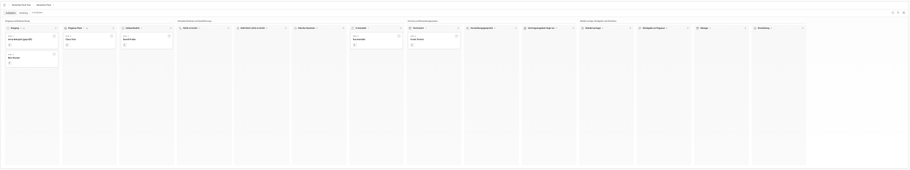
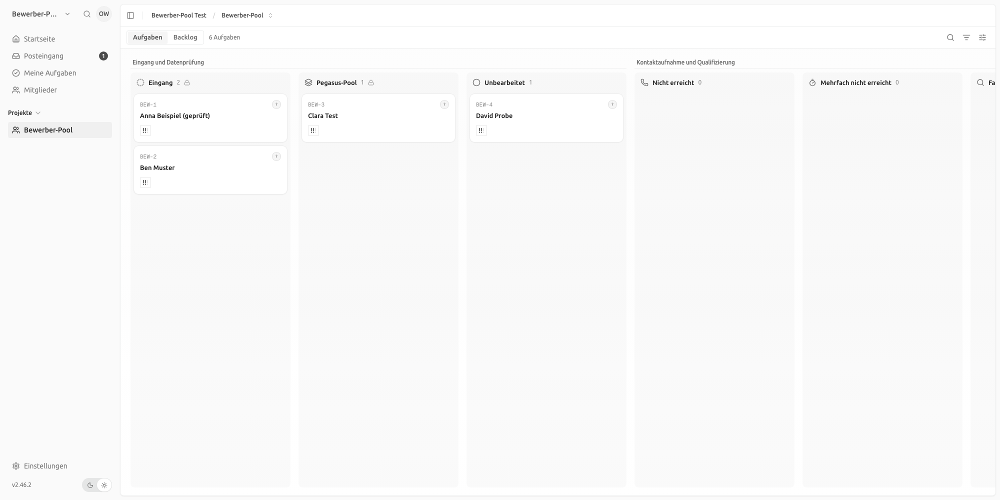
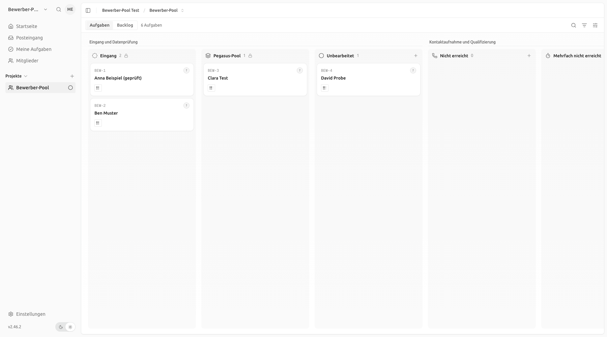
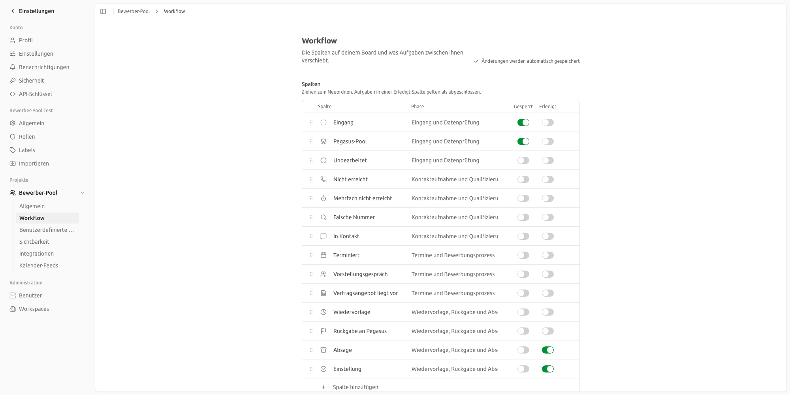

# Spalten und Phasen nach Fachkonzept — Board-Teil, Umsetzung und Nachweis

| | |
|---|---|
| **Story** | PEGA-170: Das Board bekommt Spalten, die dem beschlossenen Prozess entsprechen, damit der Stand eines Bewerbers an der Spalte ablesbar ist. 14 Stufen in vier Phasen; Eingang und Pegasus-Pool sind technisch gesteuert. Hier: der **Board-Teil** |
| **Bezug** | Fachkonzept Alexander Sitzmann vom 23.11.2026, Stakeholder-Sync 24.11.2026 (Alexander Sitzmann, Michael Polaczek, Robert Baumann). Ersetzt den Spaltensatz aus 18052, weicht bewusst von Feinkonzept Kap. 7 ab. Hub-Teil: `pegasus-hub` Branch `PEGA-170` (`docs/BOARD.md` „Spalten des Bewerber-Pools“, `bewerber-pool.template.ts`). [Register der Fork-Eingriffe](../fork-eingriffe.md#pega-170--spalten-und-phasen-nach-fachkonzept), [Betriebshandbuch](../board-einrichtung.md) |
| **Stand** | 2026-11-24, Fork `IAMDS-GMBH/pegasus-board`, Branch `th_PEGA-170`, mit `main` @ `0d26b996` zusammengeführt (Migration daher 0069) |
| **Autor** | IAMDS |

Pfadangaben beziehen sich auf die Repo-Wurzel.

---

## 0. Ergebnis auf einer Seite

| Abnahmekriterium | Befund im Board |
|---|---|
| Die 14 Stufen sind in vier Phasen gruppiert und als Phasen im Board erkennbar | **Erfüllt.** Jede Spalte trägt ihre Phase (`column.phase`). Die Kanban-Ansicht zeigt benachbarte Spalten derselben Phase unter einer gemeinsamen Überschrift, die Listenansicht eine Zwischenüberschrift vor der ersten Spalte jeder Phase. Screenshot: Abschnitt 4. |
| In Eingang und Pegasus-Pool lässt sich eine Karte nicht manuell verschieben, Felder lassen sich bearbeiten | **Erfüllt.** Beide Spalten sind gesperrt (`column.is_locked`). Ein Mitglied, auch mit `LEAD_MOVE_STAGE`, bekommt 403 `COLUMN_LOCKED` auf allen acht Wegen, die eine Karte in eine Spalte hinein oder aus ihr heraus bringen. Titel, Beschreibung, Felder und Zuweisung ändert es weiter. Owner, Instanz-Admins und das Systemkonto des Hubs sind ausgenommen. |
| Die Phasenzuordnung ist konfigurierbar und ohne Code änderbar | **Erfüllt.** Projekteinstellungen → Workflow: je Spalte „Phase“ (Freitext mit Vorschlägen) und „Gesperrt“, für alle, die Spalten bearbeiten dürfen. Das Board-Skript überschreibt eine im Board geänderte Phase, Sperre oder einen geänderten Namen nicht. |
| Der Aufbau ist dokumentiert und reproduzierbar | **Erfüllt.** `scripts/board-setup/board.json` enthält die 14 Spalten mit Phase und Sperre; `setup-board.mjs` legte sie gegen ein frisches Projekt an, ein zweiter Lauf plante nichts (Abschnitt 4). Doku: `docs/board-einrichtung.md` (Spaltentabelle, „Phasen und Sperre ändern“). |

**Entscheidung 1: Die Sperre gilt in jedem Workspace.** Die Ausnahme ist dieselbe wie bei den Rechten aus dem Hub (Owner, Instanz-Admins, `PEGASUS_HUB_USER_ID`), die Prüfung aber eine eigene (`isColumnLockExempt`). `resolveMemberAccess` meldet auch jedes Mitglied eines Workspaces, den der Hub nicht verwaltet, als „nicht geregelt“; damit wäre die Sperre dort wirkungslos. Folge: Auch ein Workspace-Administrator verschiebt nicht durch gesperrte Spalten. Er kann die Sperre aber in den Spalteneinstellungen abschalten.

**Entscheidung 2: Umbenennen im Board bleibt (Abstimmung mit dem Auftraggeber).** Bisher setzte das Board-Skript einen in der Oberfläche geänderten Spaltennamen zurück (PEGA-84). Der Name „Unbearbeitet“ ist noch offen (18083) und soll ohne Code änderbar sein. Das Skript benennt deshalb nur noch Spalten mit `"fixedName": true` zurück: „Eingang“ und „Rückgabe an Pegasus“, weil der Hub sie über den Namen findet. Phase und Sperre setzt es nur bei Spalten ohne Phase.

**Entscheidung 3: Archivieren ist kein Verschieben.** In Kaneo ist Archivieren ein Statuswechsel nach `archived`. Die Sperre lässt die virtuellen Status `archived` und `planned` durch; sie folgen ihren eigenen Rechten. Wer eine archivierte Karte wieder in eine gesperrte Spalte holt, verschiebt dagegen hinein und bekommt 403.

---

## 1. Verhalten

### Spaltensatz

| Phase | # | Spalte | Slug | Gesperrt | Erledigt |
|---|---|---|---|---|---|
| Eingang und Datenprüfung | 01 | Eingang | `eingang` | ja | |
| | 02 | Pegasus-Pool | `pegasus-pool` | ja | |
| | 03 | Unbearbeitet | `unbearbeitet` | | |
| Kontaktaufnahme und Qualifizierung | 04 | Nicht erreicht | `nicht-erreicht` | | |
| | 05 | Mehrfach nicht erreicht | `mehrfach-nicht-erreicht` | | |
| | 06 | Falsche Nummer | `falsche-nummer` | | |
| | 07 | In Kontakt | `in-kontakt` | | |
| Termine und Bewerbungsprozess | 08 | Terminiert | `terminiert` | | |
| | 09 | Vorstellungsgespräch | `vorstellungsgespräch` | | |
| | 10 | Vertragsangebot liegt vor | `vertragsangebot-liegt-vor` | | |
| Wiedervorlage, Rückgabe und Abschluss | 11 | Wiedervorlage | `wiedervorlage` | | |
| | 12 | Rückgabe an Pegasus | `rückgabe-an-pegasus` | | |
| | 13 | Absage | `absage` | | ja |
| | 14 | Einstellung | `einstellung` | | ja |

Entfallen sind Telefonqualifizierung, Zugeordnet, Kontaktiert, Termin vereinbart, Einstellungsbereit / Übergabe BSI und Ablage. Das Skript entfernt sie, solange sie leer sind; mit Karten meldet es sie und lässt sie stehen.

### API (Vertrag mit dem Hub)

| Thema | Verhalten |
|---|---|
| Felder | `phase: string \| null` (bis 100 Zeichen, getrimmt; leerer Text = `null`), `isLocked: boolean` (Standard `false`) |
| Schreiben | `POST /column/{projectId}` und `PUT /column/{id}` nehmen beide optional an. Ein `PUT` ohne die Felder lässt sie unverändert. |
| Lesen | `GET /column/{projectId}`, jede Spaltenantwort und die Board-Spalten von `GET /task/tasks/{projectId}` geben beide zurück. |
| Speicherung | `column.phase text null`, `column.is_locked boolean not null default false`, Migration `0069_column_phase_lock.sql` (idempotent). Bestehende Spalten bleiben ohne Phase und ungesperrt. |
| Sperre | 403 `{ code: "COLUMN_LOCKED", message: "Column „Eingang“ is locked: …" }` auf `PUT /task/status/{id}`, `PUT /task/{id}` (Statuswechsel), `POST /task/reorder` (nur Spaltenwechsel), `PATCH /task/bulk` (`updateStatus`), `PUT /task/move/{id}` (Quelle oder Ziel gesperrt), `POST /task/{projectId}`, `POST /task/import/{projectId}`, `POST /task/duplicate/{id}`. Geprüft nach der bestehenden Rechteprüfung, also erst `MISSING_PERMISSION`, dann `COLUMN_LOCKED`. |
| Erlaubt | Umsortieren innerhalb einer gesperrten Spalte; Titel, Beschreibung, Felder, Kommentare, Labels, Zuweisung, Anhänge; Archivieren, „Geplant“ und Löschen nach ihren eigenen Rechten. |
| Ausgenommen | Workspace-Owner, Instanz-Admins, das Konto mit der Nutzer-ID aus `PEGASUS_HUB_USER_ID`. |
| Webhooks | unverändert; ein Spaltenwechsel durch das Systemkonto geht wie bisher als `task.status_changed` an den Hub. |
| Fremde Projekte | Beim Verschieben in ein anderes Projekt prüft die Sperre das Ziel nur, wenn es im selben Workspace liegt und der Nutzer darauf Zugriff hat. Sonst lehnt der Controller ab, und die Meldung nennt keine fremde Spalte. |

### Web-App

| Thema | Verhalten |
|---|---|
| Kanban | Phasenüberschrift über jeder Gruppe benachbarter Spalten derselben Phase (`role="group"`, beschriftet mit der Phase); Spalten ohne Phase stehen ohne Überschrift auf gleicher Höhe. |
| Liste | Phase als Zwischenüberschrift vor der ersten Spalte jeder Phase. |
| Gesperrte Spalte | Schloss am Spaltenkopf mit dem Hinweis „Technisch gesteuert: …“. Für nicht ausgenommene Nutzer: Karte nicht greifbar, Spalte kein Ablageziel (auch per Tastatur), kein „+“ zum Anlegen. Statusauswahl (Kartenansicht, Unteraufgaben, Verschieben in ein anderes Projekt) und Kontextmenü zeigen die Spalte deaktiviert; liegt die Karte selbst in einer gesperrten Spalte, sind alle anderen Status deaktiviert und „Duplizieren“ fehlt. |
| Ausnahme im Web | Owner und Instanz-Admins (`useCanMoveLockedColumns`); das Systemkonto nutzt die Oberfläche nicht. Die Oberfläche spart nur den Fehlversuch, die API entscheidet. |
| Spalteneinstellungen | Spalten „Phase“ (Freitext; Vorschläge aus den vorhandenen Phasen des Projekts über eine native `datalist`; leer = keine Phase) und „Gesperrt“, auch in der Zeile „Spalte hinzufügen“. Nur mit `canManageProjects`, sonst nur lesbar. |

---

## 2. Umsetzung

- **Datenmodell:** `apps/api/src/database/schema.ts` (`columnTable.phase`, `isLocked`), Migration `apps/api/drizzle/0069_column_phase_lock.sql` mit Snapshot und Journal-Eintrag.
- **Spalten-API:** `column/schema.ts` (Zod, Normalisierung leerer Phase), `column/response.ts`, `column/index.ts`, `column/controllers/{create,update}-column.ts`.
- **Board-API:** `task/response.ts` (`boardColumnSchema`), `task/controllers/get-tasks.ts`.
- **Sperre:** `apps/api/src/column-lock/` mit drei Dateien:
  - `column-change.ts`: welche Spalten ein Statuswechsel berührt, ohne virtuelle Status.
  - `assert-columns-unlocked.ts`: eine Abfrage auf gesperrte Spalten; die Ausnahme wird nur geprüft, wenn eine betroffen ist.
  - `is-column-lock-exempt.ts`.

  Die Middlewares je Route stehen in `task/controllers/require-column-unlocked.ts`, neben `require-task-permission.ts`. Eingehängt sind sie in `task/index.ts`. `resolveDestinationStatus` in `move-task.ts` ist dafür exportiert.
- **Web:**
  - Pure Helfer `kanban-board/group-columns-by-phase.ts` und `is-locked-move.ts`.
  - Komponenten `kanban-board/phase-group.tsx` und `kanban-board/column/column-lock-hint.tsx`.
  - Hook `hooks/use-can-move-locked-columns.ts`.
  - `OptionMenuItem.disabled`, `statusMenuOptions(columns, current, canMoveLocked)`.
  - Einstellungen `project/columns/column-phase-input.tsx` und die Zeilen.
  - `phase`/`isLocked` sind in `ProjectWithTasks` optional, weil gespeicherte Abfragen und Upstream-Testdaten sie nicht kennen.
- **i18n:**
  - `settings.columnEditor.{phaseHeader,phasePlaceholder,phaseAria,lockedHeader,markLockedAria,newColumnPhaseAria,newColumnLockedAria}`
  - `tasks.kanban.lockedHint`

  Deutsch und Englisch, übrige Locales englisch. `i18n/schema.json` von Hand ergänzt.
- **Board-Skript:**
  - `board.json` mit 14 Spalten, `phase`, `isLocked`, `fixedName` und `retiredColumns`.
  - `plan-columns.mjs`: Regeln aus Entscheidung 2, entfallene Spalten löschen.
  - `setup-board.mjs`: `retiredColumns` übergeben, `phase`/`isLocked` in `--ids-out`.
- **OpenAPI:** `apps/docs/openapi.json` neu erzeugt. Der Hub zieht ihn mit `KANEO_REF=<commit>` (`pnpm hub kaneo:spec:pull`).

---

## 3. Grenzen und Folgearbeiten

- **Bulk-Leiste:** Der Statuswechsel bietet gesperrte Spalten weiter an. Die API lehnt ab, die Leiste zeigt den Fehler.
- **Mobile-App:** kennt Phase und Sperre nicht. Ein Verschieben aus einer gesperrten Spalte scheitert mit der Meldung der API.
- **Listenansicht:** Zeilen in gesperrten Spalten bleiben greifbar. Der Ablageversuch wird verworfen, nichts wird gespeichert.
- **Integrationen:** GitHub, GitLab, Gitea, Sync und Workflow-Regeln verschieben über eigene Pfade ohne Sperre. Im Bewerber-Pool sind keine Integrationen verbunden.
- **Phasen bei umsortierten Spalten:** Wer Spalten umsortiert, sieht dieselbe Phase gegebenenfalls zweimal. Das ist gewollt einfach.
- **Nicht Teil dieser Story:**
  - Sichtbarkeit von Phase 1 für Führungskräfte (Servicepaket, eigene Story).
  - Archivierung und Filter für abgeschlossene Leads (18072).
  - 24-/48-Stunden-Frist ab „Unbearbeitet“, E-Mail-Automatisierung, Eskalation.
  - Umzug von Karten aus entfallenen Spalten.

---

## 4. Nachweis

### 4.1 Gegen die lokale E2E-Umgebung

Ablauf mit `docker compose -f tests/e2e/compose.yml up --build --wait`, http://localhost:18173, Oberfläche auf Deutsch:

1. Owner registriert, Workspace und API-Schlüssel angelegt.
2. `setup-board.mjs` gegen das frische Projekt: 14 Spalten angelegt, Kaneos vier Standardspalten entfernt, Labels und Felder angelegt, 43 Änderungen. Ein zweiter Lauf mit `--dry-run` plante keine Änderung („Probelauf: nichts geschrieben.“ ohne Aktionen).
3. Sechs Karten über die API verteilt. Ein zweites Konto als Mitglied (Rolle `member`) in den Workspace aufgenommen.

| Prüfung | Ergebnis |
|---|---|
| `GET /column` nach der Einrichtung | 14 Spalten in Fachkonzept-Reihenfolge mit Phase; Eingang und Pegasus-Pool `isLocked: true`; Absage und Einstellung `isFinal: true` |
| Phasenüberschriften im Board | „Eingang und Datenprüfung“, „Kontaktaufnahme und Qualifizierung“, „Termine und Bewerbungsprozess“, „Wiedervorlage, Rückgabe und Abschluss“ |
| Mitglied: Karte aus Eingang nach Unbearbeitet (`PUT /task/status`) | 403 `COLUMN_LOCKED`, „Column „Eingang“ is locked: …“ |
| Mitglied: Titel der Karte in Eingang ändern | 200 |
| Mitglied: Karte im Board aus Eingang ziehen | nicht greifbar; Status bleibt `eingang` |
| Mitglied: Schloss-Hinweise im Board | 2 (Eingang, Pegasus-Pool); kein „+“ in beiden |
| Owner: Karte aus Eingang nach Unbearbeitet | 200 |

### 4.2 Automatisierte Tests

Testgetrieben: Jeder Test schlug zuerst aus dem erwarteten Grund fehl. Danach folgte der Code.

| Verhalten | Rot (vor dem Code) | Grün |
|---|---|---|
| `phase`/`isLocked` über Create, Update, List und Board (`tests/api-integration/column-phase-lock.test.ts`, 5 Tests) | Felder fehlten in den Antworten; `PUT` nur mit den neuen Feldern gab 500 | 5/5 |
| Sperre auf acht Wegen, je hinein und heraus (`tests/api-integration/column-lock.test.ts`, 13 Fälle), auch in nicht Hub-verwalteten Workspaces für `member` und `admin` | `expected 200 to be 403` in allen 15 Fällen | 21/21 |
| Erlaubtes bleibt erlaubt: Felder, Titel, Zuweisung, Umsortieren in der Spalte, Archivieren, Löschen; Owner, Instanz-Admin und Systemkonto verschieben | lief bereits grün; Schutz gegen eine zu weite Sperre | in 21/21 |
| Board-Skript (`scripts/board-setup/plan-columns.test.mjs`): Phase und Sperre beim Anlegen, nur ohne Phase setzen, Name im Board bleibt, `fixedName` wird zurückbenannt, entfallene Spalten löschen | 5 von 11 rot (Rückbenennung, `fixedName` im Body, keine Phase, keine Löschung, `retiredColumns` fehlt) | 38/38 im Ordner |
| Gruppierung nach Phase (`group-columns-by-phase.test.ts`) | Modul fehlte | 4/4 |
| Gesperrter Zug (`is-locked-move.test.ts`) | Modul fehlte | 5/5 |
| Board: Phasenüberschriften, keine Ablage in oder aus gesperrten Spalten, Karte nicht greifbar, Owner ausgenommen (`filtered-drag.test.tsx`) | Gruppe fehlte; Vorschau und Ablage in gesperrte Spalte liefen | 22/22 |
| Liste: Zwischenüberschriften, Ablage verworfen, Schloss, kein „+“ (`list-view/index.test.tsx`) | Überschriften fehlten; `mutate` wurde aufgerufen | 24/24 im Ordner |
| Spaltenkopf: Schloss, kein „+“ (`column-header.test.tsx`) | Schloss fehlte | 8/8 im Ordner |
| Spalteneinstellungen: Phase speichern und leeren, Vorschläge, Sperre schalten, beim Anlegen, nur lesbar ohne Recht (`column-list.test.tsx`) | Eingaben fehlten | 9/9 |
| Statusauswahl: deaktivierte Option weder per Klick noch per Zifferntaste (`option-menu.test.tsx`), gesperrte Status (`status-menu-options.test.ts`), Kontextmenü (`task-card-context-menu-content.test.tsx`) | `onSelect` aufgerufen; nichts deaktiviert | 8/8, 7/7 |

Ein Testfehler wurde offen korrigiert: Im ersten Board-Test lagen die Spalten unter `data`. Im Einstellungstest löst `blur()` in jsdom ohne Fokus kein Ereignis aus; der Test ruft deshalb wie der bestehende Umbenennungstest `fireEvent.blur` auf.

---

## 5. Gelaufen

| Befehl | Ergebnis |
|---|---|
| `pnpm --filter @kaneo/api exec vp test run --config vitest.integration.config.ts ../../tests/api-integration/column-lock.test.ts` | 21 passed |
| `… ../../tests/api-integration/column-phase-lock.test.ts` | 5 passed |
| Nachbarn: `hub-permissions`, `task-reorder`, `bulk-task-atomic-status`, `bulk-task-events`, `task-mutation-parity`, `authorization-boundaries`, `tenant-resource-boundaries`, `hub-return-task`, `workspace-rbac`, `openapi`, `column-*` | 12 Dateien, 213 passed; `column-slug`, `column-live-updates`, `column-migration-once`, `openapi` 26 passed |
| `pnpm test:integration` | 170 Dateien, 1982 passed, 3 skipped |
| `pnpm --filter @kaneo/web exec vp test run --config vitest.config.ts` | 333 Dateien, 1784 passed |
| `node --test "scripts/board-setup/*.test.mjs"` | 38 passed |
| `pnpm --filter @kaneo/api typecheck`, `pnpm --filter @kaneo/web typecheck` | ohne Fehler |
| `pnpm exec vp check` (alle geänderten Dateien) | pass |
| `pnpm openapi:check:fix` | `apps/docs/openapi.json` neu erzeugt |
| `pnpm i18n:check:fix`, `pnpm i18n:check` | alle Locales synchron |
| E2E-Umgebung mit `setup-board.mjs` und Playwright-Skript | siehe 4.1 |

---

## 6. Konfliktpotenzial

Mittel. Neu sind `apps/api/src/column-lock/`, `require-column-unlocked.ts` und einige Web-Helfer. Geändert sind upstream oft bearbeitete Stellen:

- `task/index.ts`: Middleware-Ketten von acht Routen.
- `kanban-board/index.tsx`: Die Spaltenschleife steht jetzt in `PhaseGroup`.
- `list-view/index.tsx`, `option-menu.tsx`, `status-menu-options.ts`, die Zeilen der Spalteneinstellungen.
- `boardColumnSchema` und `get-tasks.ts`.

Die Migration muss beim nächsten Sync hinter die letzte Upstream-Migration rücken; Upstream ist bereits bei 0073. Neue Upstream-Routen, die den Status setzen, brauchen die Sperre; `column-lock.test.ts` ist dafür die Liste. Details: [Register](../fork-eingriffe.md#pega-170--spalten-und-phasen-nach-fachkonzept).

---

## 7. Nachtrag 26.11.2026: technische Stufen nur für Pegasus und Key-Account-Admin

**Anlass:** Die technischen Stufen vor der „Qualifizierung“ sollen für Führungskräfte und alle Ebenen darunter unsichtbar sein, für Pegasus und den Key-Account-Admin sichtbar. Wer sie sehen darf, entscheidet der Hub und schickt es als Recht `LEAD_READ_INTAKE` im bestehenden Sichtbereich-Snapshot (`PUT /pegasus-visibility/workspace/{workspaceId}/users`, Feld `permissions`). Der Snapshot braucht keine Schemaänderung, unbekannte Schlüssel speichert das Board schon. Hub-Teil: `pegasus-hub` Branch `th_PEGA-170`. Stand: Branch `th_PEGA-170` von `main` @ `980ef14`, Migration 0070.

| Anforderung | Befund im Board |
|---|---|
| Spalten-Flag „eingeschränkt“ | **Erfüllt.** `column.is_restricted` (Standard `false`, nicht null, Migration 0070 idempotent). `POST /column/{projectId}`, `PUT /column/{id}`, `GET /column/{projectId}` und `BoardColumn` tragen `isRestricted` direkt nach `isLocked`. `apps/docs/openapi.json` ist byte-gleich mit dem Kaneo-Snapshot des Hubs (`diff` leer), der nächste `kaneo:spec:pull` ändert also nichts. Spalteneinstellungen: Schalter „Intern“ neben „Gesperrt“, Tooltip und Screenreader-Text „Nur für Pegasus und Key-Account-Admin sichtbar“. |
| Ohne `LEAD_READ_INTAKE` weder Spalten noch Karten sichtbar | **Erfüllt** auf Board, Liste, Spaltenliste, Suche (Karten, Kommentare, Aktivitäten), Projektstatistik, „Meine Aufgaben“ samt Zähler, Unteraufgaben-Zähler, Verknüpfungen, Detail per ID und Link (404), Beschreibung, Verlauf, Kommentare, Anhänge, Export, Feldwerte, Workflow-Regeln, Benachrichtigungen. Öffentliche Boards zeigen eingeschränkte Spalten nie. |
| Kein Ziel für Verschieben oder Anlegen | **Erfüllt.** Statuswechsel, volles Update, Umsortieren, Bulk, Verschieben in ein anderes Projekt, Anlegen und Import antworten 400 `Invalid status`. Eine Karte aus einer eingeschränkten Spalte zu holen scheitert schon an der Sichtbarkeit (404). |
| Ausnahmen | **Erfüllt.** Owner, Instanz-Admins und das Systemkonto des Hubs (`PEGASUS_HUB_USER_ID`, auch per API-Key) sehen alles, wie bei der Sperre. In Workspaces, die der Hub nicht verwaltet, gilt die Einschränkung nicht (wie die Rechte aus dem Hub). |
| Ein Filterpfad | **Erfüllt.** Kein zweiter Filter: `TaskScope` aus PEGA-141/142 bekommt `hidesRestrictedColumns`, `taskVisibleCondition` prüft zusätzlich, dass die Karte nicht in einer eingeschränkten Spalte liegt. Jeder Lesepfad, der den Sichtbereich schon nutzte, filtert damit auch die technischen Stufen. |
| Board-Skript, 17 Spalten | **Erfüllt.** `board.json` mit Eingang, Plausibilitätsprüfung, Automatische Anreicherung (gesperrt, eingeschränkt), Manuelle Anreicherung, Pegasus-Pool (eingeschränkt, nicht mehr gesperrt), Qualifizierung (`formerName: "Unbearbeitet"`, Slug `unbearbeitet` bleibt). Wie im Hub gewinnt die Vorgabe bei jedem Lauf: Name, Phase, Sperre und Einschränkung jeder Vorgabespalte; unbekannte Spalten bleiben. |
| Sperre: Tests in beide Richtungen | **Erfüllt.** Anlegen, Bulk, Statuswechsel und Import waren schon im `DENIED`-Satz von `column-lock.test.ts` (hinein und, wo es ein Heraus gibt, heraus). Neu: Kommentar und Label an einer Karte in Eingang bleiben erlaubt; ein Import mit einer gesperrten Zielspalte wird als Ganzes abgelehnt. |

**Entscheidung 4: Ziel in einer eingeschränkten Spalte = unbekannter Status (400).** Ein 403 mit eigenem Code würde verraten, dass die Spalte existiert. Die Prüfung läuft vor der Sperre, damit `COLUMN_LOCKED` keine unsichtbare Spalte nennt („Eingang“ ist beides). Alle betroffenen Routen dokumentieren 400 schon; die OpenAPI bleibt unverändert.

**Entscheidung 5: Statuswechsel durch eingeschränkte Spalten fehlen im Verlauf (Abstimmung mit dem Auftraggeber).** Nach der Freigabe sieht die Führungskraft die Karte wieder. Einträge, deren alter oder neuer Status eine eingeschränkte Spalte ist (etwa „Pegasus-Pool → Qualifizierung“), fehlen für sie im Kartenverlauf, im Workspace-Feed, in der Aktivitätssuche und in Benachrichtigungen; neue Statusbenachrichtigungen dieser Art entstehen für sie nicht.

**Entscheidung 6: Die Vorgabe gewinnt.** Wie im Hub setzt jeder Lauf des Skripts Name, Phase, Sperre und Einschränkung zurück; `fixedName` entfällt. Damit gilt Entscheidung 2 nicht mehr: Ein in den Spalteneinstellungen geänderter Name bleibt nur bis zum nächsten Lauf.

**Folgen und Grenzen:**
- Kalender-Feed und Integrations-Sync (`denyTaskScoped`) sperren jetzt auch Mitglieder, die nur die Einschränkung trifft, etwa eine Führungskraft im Modus „alle Einheiten“ ohne `LEAD_READ_INTAKE`. Beide lassen sich nicht auf den Sichtbereich zuschneiden.
- Realtime: `TASKS_REORDERED` nennt Status und Position aller bewegten Karten. Wer eine davon nicht sieht, bekommt stattdessen `PROJECT_UPDATED` und lädt das Board neu. Die übrigen Ereignisse tragen nur IDs; ein 404 beim Nachladen lässt das Web das Board neu laden, die Karte verschwindet.
- Die Fehlermeldung eines sonst ungültigen Status listet weiter alle Slugs des Projekts auf (Upstream-Verhalten), also auch die der eingeschränkten Spalten.
- Wer Spalten bearbeiten darf (`project:update`), aber kein `LEAD_READ_INTAKE` hat, bekommt auf `PUT`/`DELETE /column/{id}` einer eingeschränkten Spalte 404. Beim Umsortieren aller Spalten sieht er sie nicht; ihre Positionen bleiben.
- Nebenbei behoben: Die Benachrichtigungsprüfung für „nur zugewiesene“ Rollen nannte die nicht vorhandene Spalte `user_id` und brach mit einem SQL-Fehler ab (Test „lists a Bearbeiter's notifications…“ schlägt ohne die Korrektur fehl).

### Gelaufen (26.11.2026)

| Prüfung | Ergebnis |
|---|---|
| `pnpm test:integration` (gesamt) | 171 Dateien, 2018 Tests grün nach Anpassung von `hub-permissions-side-routes.test.ts` (Mitglied im Modus „alle“ braucht jetzt `LEAD_READ_INTAKE`, um am Sichtbereich-Wächter des Syncs vorbeizukommen); die Datei danach einzeln: 11/11 |
| `column-restricted.test.ts` (neu) | 31 Tests: je Lesepfad ein Test, acht Ablehnungen, vier Ausnahmen, Modus „alle“ ohne Recht, nicht verwalteter Workspace |
| `column-lock.test.ts`, `column-phase-lock.test.ts`, `notification-hub-scope.test.ts` | grün |
| API-Unit-Tests mit unerreichbarer `DATABASE_URL` | 130 Dateien, 1025 Tests grün |
| Web `pnpm exec vp test run` | 333 Dateien, 1786 Tests grün |
| `packages/permissions` | 15 Tests grün |
| `node --test "scripts/board-setup/*.test.mjs"` | 39 grün |
| `pnpm typecheck`, `pnpm lint`, `pnpm i18n:check`, `pnpm openapi:check` | grün; `diff` gegen den Hub-Snapshot leer |
