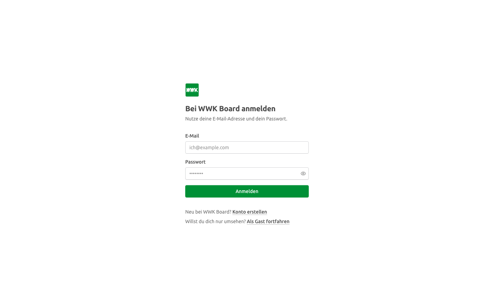
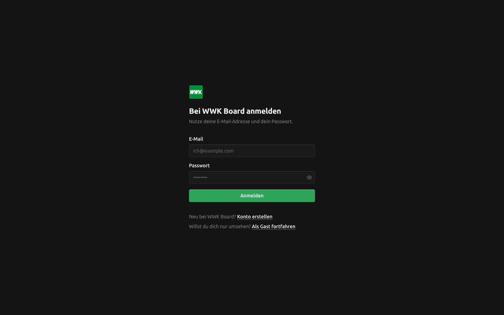
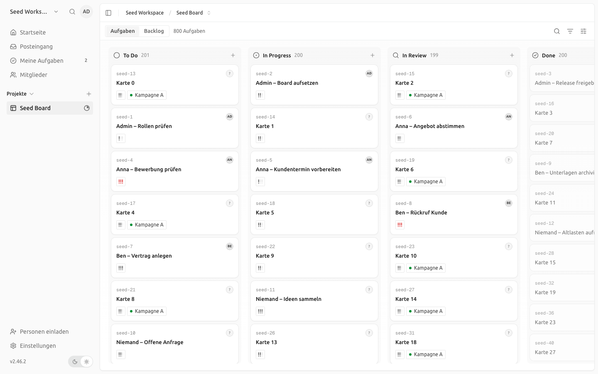
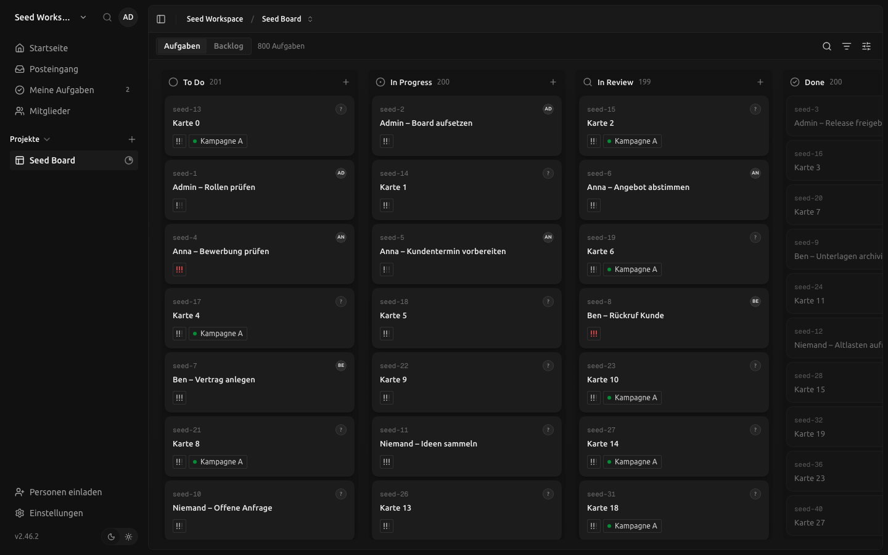
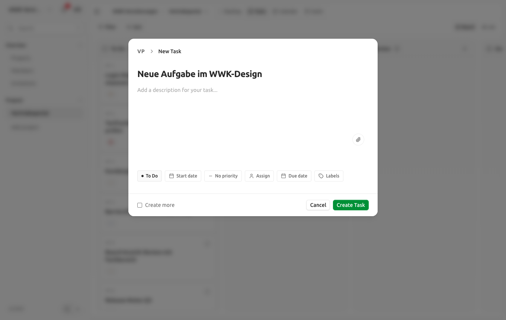

# WWK-Theme: Token-Set, Aktivierung und Grenzen

Dieses Dokument beschreibt das WWK-Erscheinungsbild der Web-App als **Theme, nicht als Redesign** (Leitlinie Kapitel 17): Es werden ausschließlich Design-Tokens (Farben, Schrift, Radius), das Logo und der Produktname ausgetauscht. Layout, Komponentenstruktur und Verhalten bleiben unverändert. Damit ist die Aussage „eigene Oberfläche im WWK-Design“ aus Kapitel 2 an Anmeldeseite und Board-Ansicht überprüfbar.

## Aktivierung

Das WWK-Theme ist der **Standard**: Ohne weitere Konfiguration (oder bei unbekanntem Wert) startet die Web-App im WWK-Design. Über die Vite-Variable `VITE_BRAND` lässt sich zur Build-/Dev-Zeit auf das unveränderte Kaneo-Basisbild umschalten, z. B. für Vergleiche.

```bash
# Standard: WWK
pnpm --filter @kaneo/web dev

# Kaneo-Basisbild zum Vergleich
VITE_BRAND=kaneo pnpm --filter @kaneo/web dev
# oder dauerhaft in apps/web/.env.local
VITE_BRAND=kaneo
```

Beim Start setzt `applyBrand()` (`apps/web/src/brand/apply.ts`) die Klasse `theme-wwk` auf `<html>`. Die Klasse liegt neben `light`/`dark`, daher funktionieren Hell- und Dunkelmodus unverändert.

Titel, Icons und Manifest kommen aus dem Build (PEGA-92): Das Vite-Plugin `apps/web/brand-html-plugin.ts` schreibt `index.html` in Entwicklung und Build mit `brandIndexHtml()` (`apps/web/src/brand/brand-index-html.ts`) um. Titel, `application-name`, `apple-mobile-web-app-title`, Beschreibung, Favicons, Apple-Touch-Icon, Manifest und `theme-color` kommen aus der Marke. OpenGraph-/Twitter-Tags, `canonical` und das Plausible-Skript von kaneo.app entfallen. `index.html` selbst bleibt die Upstream-Datei. `brand-index-html.test.ts` läuft gegen sie und schlägt fehl, sobald ein Upstream-Update wieder „Kaneo“ in den Kopf bringt.

Die API kennt keinen Build-Schalter. E-Mails und Chat-Benachrichtigungen nennen den Namen aus `APP_NAME` in der Root-`.env`, Standard „WWK Board“ (`packages/email/src/components/app-name.ts`).

## Token-Set

Quelle der Markenwerte sind die gelieferten Logodateien (`wwk-logo-4c.svg`, `wwk-logo-rgb.svg`, `wwk-logo-1c.svg`, `wwk-logo-negativ.svg`) und die Ubuntu-Schriftfamilie (Ubuntu Font Licence 1.0).

Abgleich mit dem Brand-Package vom 2026-10-21 (Niklas Finnemann): `apps/web/public/brands/wwk/logo.svg` ist inhaltlich identisch mit `wwk-logo-rgb.svg`. Die Schrift ist dieselbe Ubuntu-Familie, die die App über `@fontsource/ubuntu` lädt. Das Package enthält kein Farbblatt. Es bestätigt nur Grün `#009036` und Orange `#ee7d00` (aus den Logodateien). Die übrigen Werte unten stammen weiter von wwk.de.

### Markenwerte

Zusätzlich zu den Logodateien wurde das öffentliche Stylesheet von wwk.de (`main.bundle.css`, `font.bundle.css`) ausgewertet, um Schrift, Textfarbe, Flächen und Button-Farben zu übernehmen.

| Token | Wert | Herkunft |
|---|---|---|
| `--brand-green` | `#009036` | Wortmarke, Claim, Primär-Button und Fokus-Outline auf wwk.de |
| `--brand-green-dark` | `#008237` | Hover/Headline-Grün auf wwk.de |
| `--brand-orange` | `#ee7d00` | Trennlinie unter der Wortmarke, Badges auf wwk.de |
| `--brand-orange-cta` | `#ee6608` | Sekundär-Button auf wwk.de (häufigste Akzentfarbe der Seite) |
| `--brand-orange-dark` | `#ba4e21` | Linkfarbe auf wwk.de |
| `--brand-text` | `#4a4a4a` | Fließtext- und Überschriftenfarbe auf wwk.de |
| `--brand-surface`, `--brand-line`, `--brand-line-strong` | `#f2f2f2`, `#e7e8e8`, `#d0d1d2` | Eingabefeld-Hintergrund und Graustufen auf wwk.de |
| Schrift | Ubuntu 300/400/500/700 (+ 400 kursiv) | von WWK gelieferte Schriftfamilie; wwk.de nutzt Ubuntu Light als Grundschrift; `@fontsource/ubuntu` |
| Produktname | „WWK Board“ | Abstimmung im Projekt |

### Zuordnung auf die semantischen Tokens (`apps/web/src/index.css`, Blöcke `.theme-wwk` und `.theme-wwk.dark`)

| Semantisches Token | Hell | Dunkel | Wirkung |
|---|---|---|---|
| `--font-sans` (und damit `--font-heading`) | Ubuntu | Ubuntu | gesamte UI-Typografie inklusive Überschriften |
| `--radius` | `0.25rem` (Kaneo: `0.625rem`) | gleich | fast eckige Buttons, Karten, Eingaben wie auf wwk.de |
| `--foreground`, `--card-foreground`, `--popover-foreground`, `--accent-foreground`, `--secondary-foreground` | `#4a4a4a` | Basiswert dunkel (helles Neutral) | Textfarbe |
| `--muted`, `--secondary` | `#f2f2f2` | Basiswert dunkel | Flächen, Zähler-Badges, sekundäre Buttons |
| `--border`, `--input` | `#e7e8e8`, `#d0d1d2` | Basiswert dunkel | Rahmen, Eingabefelder |
| `--primary` / `--primary-foreground` | Grün / Weiß | aufgehelltes Grün (`color-mix` 82 % Grün + Weiß) / Weiß | Primär-Buttons, aktive Zustände |
| `--ring`, `--sidebar-ring` | Grün | aufgehelltes Grün | Fokusringe (wwk.de: 2 px Outline in Grün) |
| `--sidebar-primary` / `-foreground` | Grün / Weiß | aufgehelltes Grün / Weiß | aktive Sidebar-Einträge |
| `--success` / `-foreground` | Grün / `#008237` | aufgehelltes Grün / helles Grün | Erfolgsmeldungen, erledigte Zustände |
| `--warning` / `-foreground` | `#ee6608` / `#ba4e21` | `#ee6608` / helles Orange | Warnungen, Priorität „medium/high“ |
| `--chart-1` … `--chart-5` | Grün, CTA-Orange, Dunkelgrün, Neutral, Logo-Orange | analog aufgehellt | Diagramme |

Bewusst **nicht** überschrieben: `--info` (Blau) und `--destructive` (Rot) behalten ihre semantische Bedeutung. Im Dunkelmodus bleiben Hintergründe und Textfarben neutral, da wwk.de keinen Dunkelmodus definiert. Deshalb stehen die Grautöne im Block `.theme-wwk:not(.dark)`.

**Fehler bis PEGA-92:** Die Grautöne standen im Block `.theme-wwk`. Er steht in `index.css` nach `.dark` und hat dieselbe Spezifität, deshalb galten sie auch im Dunkelmodus. Ergebnis: dunkelgrauer Text `#4a4a4a` auf dunklem Grund und hellgraue Flächen `#f2f2f2`. Behoben, indem die Grautöne nur noch im Hellmodus gelten.

### Abgleich mit wwk.de

Übernommen als Token: Ubuntu als einzige Schrift (Fließtext und Überschriften), Textgrau `#4a4a4a`, Grün für Primäraktionen und Fokus, CTA-Orange `#ee6608` und Link-Orange `#ba4e21` für Warnzustände, graue Flächen und Rahmen, fast eckige Ecken.

Nicht übernommen, weil es keine Tokens sind oder in einer dichten App-Oberfläche schadet:

- **Versalien-Buttons** (`text-transform: uppercase`) und **komplett eckige Buttons** (`border-radius: 0`) sind Komponentenstil, kein Token. Der Radius wurde auf `0.25rem` gesenkt, Großschreibung nicht eingeführt.
- **Ubuntu Light (300) als Fließtextgewicht**: Das Gewicht ist in den Komponenten gesetzt, nicht als Token. Bei 13–14 px UI-Text wäre Light schlecht lesbar; wwk.de nutzt es bei 16–18 px.
- **Fira Sans für Headlines**: wwk.de setzt große Headlines in Fira Sans Light (27 px, Gewicht 300) und kleine Titel in Fira Sans ExtraBold (800). WWK hat für die Plattform nur die Ubuntu-Familie geliefert, daher laufen alle Überschriften in Ubuntu. Das Überschriftengewicht ist ohnehin in der Basisschicht fest auf 600 gesetzt und kein Token.
- **Linkfarbe Orange** (`#ba4e21`): Links in der App nutzen die Textfarbe bzw. Primärfarbe der Komponenten; es gibt kein Link-Token.
- **Platzhaltergrau** `#969899` von wwk.de erreicht auf Weiß nur ca. 2,9:1 Kontrast und wurde nicht für `--muted-foreground` übernommen.

### Logo und Produktname (`apps/web/src/brand/index.ts`)

| Feld | Kaneo | WWK |
|---|---|---|
| `name` | Kaneo | WWK Board |
| `logo.onLight` | `/logo-dark.svg` | `/brands/wwk/logo.svg` (4c) |
| `logo.onDark` | `/logo-light.svg` | `/brands/wwk/logo-negative.svg` (weiß) |
| `logo.heightClassName` | `h-6` | `h-16` |
| `favicon` | `/favicon.svg` | `/brands/wwk/favicon.svg` (Wortmarke weiß auf Grün) |
| `document` | – (`index.html` bleibt) | Beschreibung, PNG-/ICO-Favicon, Apple-Touch-Icon, Manifest `/brands/wwk/site.webmanifest`, `theme-color` `#ffffff` |
| `upstreamLinks` | ja | nein: kein „Powered by Kaneo“, keine kaneo.app-Links für AGB, Datenschutz und Doku |

Der Produktname fließt in den Browser-Tab (`PageTitle`), in den Alt-Text des Logos und über die i18n-Variable `{{appName}}` in Texte. Seit PEGA-92 steht `{{appName}}` in allen 21 Sprachen an jeder Stelle, an der die Namensräume `common`, `auth`, `settings`, `invitations` und `mobile` das Produkt nennen. `landing` und `press` gehören zur Upstream-Website kaneo.app und bleiben unverändert.

Die Icons in `apps/web/public/brands/wwk/` werden aus `favicon.svg` erzeugt (`icon-maskable.svg` mit kleinerer Wortmarke für die Android-Schutzzone):

| Datei | Größe | Verwendung |
|---|---|---|
| `favicon.svg`, `favicon-96x96.png`, `favicon.ico` (16/32/48) | | Browser-Tab |
| `apple-touch-icon.png` | 180 | iOS-Startbildschirm |
| `icon-192x192.png`, `icon-512x512.png` | 192, 512 | Manifest `any` |
| `icon-maskable-192x192.png`, `icon-maskable-512x512.png` | 192, 512 | Manifest `maskable` (Android) |
| `site.webmanifest` | | Name und Kurzname „WWK Board“, Hintergrund und Theme `#ffffff` |

## Exemplarisch umgesetzte Ansichten

- **Anmeldeseite** (`/auth/sign-in`): WWK-Logo, Ubuntu, grüner Primär-Button, grüne Fokusringe, Tab-Titel „Sign In · WWK Board“.
- **Board-Ansicht** (Kanban): Ubuntu, grüne Primäraktionen (z. B. „Create Task“ im Aufgaben-Dialog), grüne Fokusringe, orangefarbene Prioritätsmarker, reduzierter Eckenradius. Spalten, Karten, Toolbar und Sidebar sind strukturell unverändert. Die Board-Fläche selbst ist bewusst neutral gehalten (weiße/graue Karten, keine Primärfarbe im Ruhezustand), daher zeigt sich die Marke dort vor allem über Schrift, Radius und Aktionen.

Beide Ansichten funktionieren im Hell- und Dunkelmodus. Die Screenshots stammen aus dem lokalen Dev-Lauf vom 2026-10-21 (PEGA-92, Oberfläche Deutsch). Die Aufnahme „Aufgabe anlegen“ stammt noch aus der ersten Iteration.

| Ansicht | Hell | Dunkel |
|---|---|---|
| Anmeldeseite |  |  |
| Board |  |  |
| Board, Aufgabe anlegen |  | – |

## Grenzen des Themings

Was ohne Eingriff in Layout, Komponentencode oder Build-Prozess **nicht** erreichbar ist:

1. **Logo-Proportionen.** Das WWK-Logo ist ein gestapeltes Zeichen mit Claim (300×159), die Kaneo-Wortmarke ist breit (450×104). Auf der Anmeldeseite braucht das WWK-Logo `h-16` statt `h-6`, wodurch die Karte etwas nach unten rückt. In der Sidebar gibt es keinen Platz für ein Produktlogo (dort sitzt der Workspace-Umschalter mit dem Workspace-Logo). Ein WWK-Logo in der Sidebar wäre eine Layout-Änderung.
2. **Statische Build-Artefakte.** Mit PEGA-92 erledigt: Titel, Meta-Tags, Manifest und Icons kommen aus dem Build (siehe Aktivierung). Eine Link-Vorschau (OpenGraph) mit WWK-Bild gibt es nicht. Die Tags von kaneo.app werden entfernt, nicht ersetzt.
3. **Produktname in Texten.** Mit PEGA-92 erledigt: Web, Mobile-App, E-Mails und Chat-Benachrichtigungen nennen „WWK Board“. Technische Kennungen bleiben bewusst: der Header `X-Kaneo-Signature` (wird im Hinweistext des generischen Webhooks genannt), die Geräte-Client-ID `kaneo-cli` (Fehlermeldung bei falsch konfiguriertem Server), Paket- und Store-Kennungen der Mobile-App, der Dateiname `kaneo.ics` des Kalender-Feeds und die OpenAPI-Beschreibungen der API.
4. **Semantische Farben.** Info (Blau) und Fehler/Löschen (Rot) liegen außerhalb der WWK-Palette und bleiben bewusst erhalten. Orange ist auf „Warnung“ gelegt; dadurch erscheinen Prioritäten „medium/high“ orange.
5. **Kontrast.** Weißer Text auf `#009036` erreicht ca. 4,2:1. Das genügt für UI-Komponenten und große Schrift (WCAG 3:1), liegt aber unter AA für Fließtext (4,5:1). Der Markenwert wurde nicht verändert; im Dunkelmodus wird ein aufgehelltes Grün verwendet.
6. **Typografie und Form jenseits der Tokens.** Schriftgrößen-Skala, Gewichte (Light-Fließtext, Light/ExtraBold-Headlines von wwk.de), Versalien, Abstände, die Sidebar-Variante („inset“), Kartenaufbau und Pillen-Badges sind Komponentencode, keine Tokens. Ubuntu läuft breiter als Geist; einige Labels werden früher abgeschnitten (`truncate`).
7. **Upstream-Hinweise.** Mit PEGA-92 sind „Powered by Kaneo“, die AGB-/Datenschutz-Links und der Link auf die Kaneo-Doku bei CORS-Fehlern für WWK ausgeblendet. Die E-Mail-Fußzeile zeigt keine kaneo.app-Links mehr. Eigene WWK-Seiten für Impressum und Datenschutz sind noch nicht festgelegt. Die Versionsanzeige (Link auf das Upstream-Changelog) bleibt, sie nennt Kaneo nicht.
8. **Nutzerdaten.** Workspace-Logos, Label-Farben und Avatare sind Daten der Nutzer und werden vom Theme nicht beeinflusst.
9. **Nur Build-Zeit.** Der Wechsel zwischen WWK und Kaneo-Basisbild erfordert einen neuen Web-Build bzw. ein neues Web-Image. Ein Laufzeit-Platzhalter (wie `KANEO_API_URL` in `apps/web/env.sh`) wurde bewusst nicht ergänzt.

## Beteiligte Dateien

- `apps/web/src/brand/index.ts`, `apply.ts`, `index.test.ts` – Brand-Definition und Bootstrap
- `apps/web/src/index.css` – Ubuntu-Import und Token-Blöcke `.theme-wwk` / `.theme-wwk.dark`
- `apps/web/src/components/common/logo.tsx`, `page-title.tsx`, `src/lib/i18n/index.ts`, `src/main.tsx`
- `apps/web/public/brands/wwk/` – `logo.svg`, `logo-negative.svg`, `favicon.svg`
- `apps/web/src/brand/brands.ts`, `brand-index-html.ts` (+ Test), `apps/web/brand-html-plugin.ts`, `vite.config.ts`, `tsconfig.node.json` – Build-Zeit-Branding von `index.html` (PEGA-92)
- `apps/web/public/brands/wwk/` – zusätzlich Icons, `favicon.ico`, `site.webmanifest`; `apps/web/public/email/mark-wwk.png`
- `i18n/*.json` – `{{appName}}` in allen Sprachen (PEGA-92)
- `packages/email/src/components/app-name.ts` (+ Test) – `APP_NAME` für E-Mails und API-Texte
- `apps/mobile/` – Name, Icons, Logo (`src/components/brand.tsx`), `src/lib/brand.ts`
- `ENVIRONMENT_SETUP.md`, `.env.sample` – `VITE_BRAND`, `APP_NAME`
